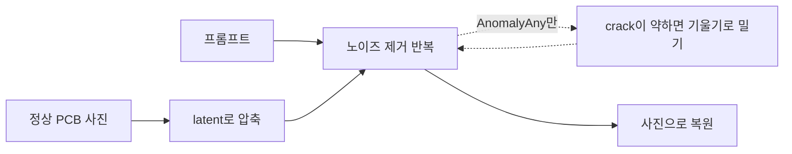

# 생성형 AI를 활용한 제조 결함 데이터 생성

정상 PCB 사진에 균열(crack) 결함을 생성하면서, 강사 노트북 8-1(Stable Diffusion, Inpainting)과
8-2(AnomalyAny)의 결과가 왜 그렇게 나왔는지 실험으로 확인한 프로젝트입니다.

> 모두의연구소 AX Bootcamp · 컴퓨터 비전 · 프로젝트 노드 8

## 데이터와 환경

| 항목 | 내용 |
| --- | --- |
| 원본 사진 | 강사 실습의 정상 PCB 사진 1장 (`normal.png`, 512×512로 줄여 사용) |
| 결함 | crack (균열) |
| 생성 모델 | Stable Diffusion 1.5, SD1.5 Inpainting, AnomalyAny (CVPR 2025) |
| 라이브러리 | diffusers 0.33.1, transformers 4.52.4 (강사 버전) |
| GPU | Colab T4 |

불량 사진은 드물고, 이상탐지(노드 6)는 정상과 다르다는 것까지만 알려 줍니다. 균열인지 긁힘인지 구분하려면
불량 종류별 사진이 있어야 해서, 부족한 사진을 생성으로 채워 보려는 것입니다.

## 실행 흐름



## 결과

| 실험 | 바꾼 것 | 결과 |
| --- | --- | --- |
| A1 | guidance 1 / 7.5 / 20 | 1은 연필 스케치, 7.5는 사진, 20은 만화처럼 과함. 시간은 셋 다 4.5초 |
| A2 | fp32 → fp16 | 메모리 6.33 → 3.42GB, 시간 19.44 → 5.01초, 그림은 거의 같음 |
| A3 | steps 10 / 20 / 30 / 50 | 시간은 단계 수에 비례(1.73 → 7.59초), 그림은 20~30에서 충분, 50은 더 좋아지지 않음 |
| B1 | 실제 PCB + 작은 마스크 + crack | 균열은 거의 안 생기고, 마스크 바깥 글자(`IN+`, `R400`)까지 뭉개짐 |
| B2 | 마스크 바깥에 원본 되붙이기 | 글자는 돌아오고 경계에 이음새가 생김 |
| C1 | AnomalyAny 원본 충실도 0.3 vs 0.7 | T4에서 OOM. 해상도, fp16, autocast 다 안 돼서 강사 출력을 분석함 |

### A1. guidance


guidance를 올리면 프롬프트를 더 잘 따를 줄 알았는데, 20은 오히려 사진이 아니라 만화처럼 나왔습니다.

### A2. fp32 vs fp16


### A3. steps: 생성 모델의 "적절한 상태" 확인


생성 모델은 학습하지 않아서 epoch 대신 노이즈 제거 단계 수(steps)가 결과를 정한다. 10은 윤곽이 번지고, 20에서 형태가
다 잡히고, 30에서 바이저 반사 같은 세부가 생겼다. 50은 시간이 1.7배인데 색과 다리 모양만 달라지고 더 좋아지지 않았다.
20이 30%쯤 빠르지만, 균열은 가늘고 작은 결함이라 세부가 생기는 30을 고르겠다.

### B1, B2. Inpainting과 원본 되붙이기


윗줄은 글자 확대(원본 / Inpainting / 되붙이기), 아랫줄은 마스크 경계 확대입니다.

### C. AnomalyAny 결과 (강사 출력)


왼쪽부터 원본 / AnomalyAny 결과 / crack 단어의 attention map, 아래는 왼쪽 USB 커넥터 확대입니다.
attention이 가장 강한 곳에서 커넥터가 찢어져 있습니다.

### C1. GPU 메모리


## 주요 발견

1. **AnomalyAny는 crack을 밀어 넣은 자리를 바꾸지만, 균열로 그린 건 4장 중 1장이었다.** 처음엔 결과에서 균열이 안
   생겼다고 생각했다. 기판 위만 봤기 때문이다. attention map이랑 나란히 놓으니 첫 장은 빨간 곳이 USB 커넥터였고,
   확대해 보니 커넥터가 찢어져 있었다. 나머지 3장도 attention이 모인 자리(주로 커넥터 주변)가 바뀌었지만, 커넥터가
   다른 부품으로 바뀌거나 얼룩이 생겼을 뿐 균열 모양은 아니었다. 모델이 PCB 기판 균열을 거의 못 봤으니,
   자기가 아는 범위의 변화로 바꿔 그린 것 같다.

   
2. **Inpainting도 마스크 바깥을 바꾼다.** 마스크 바깥은 그대로일 줄 알았는데 글자가 뭉개졌다. Inpainting도 사진 전체를 latent로 압축했다가 복원하기 때문이다.
   노드 6 슬라이드에서 AutoEncoder가 압축하면 세부가 사라진다고 했던 것과 같은 원리로 보인다. 원본을 되붙이면 글자는 돌아오지만 경계에 이음새가 남는다.
3. **생성 사진을 그대로 학습에 쓰면 미탐이 생길 수 있다.** 생성한 불량은 글자가 뭉개져 있고 실제 정상 사진은 선명해서,
   모델이 균열 대신 "글자가 뭉개졌나"로 구분할 수 있다. 그러면 글자가 선명한 진짜 균열 PCB를 정상으로 넘긴다.
   생성한 사진은 그대로 쓰면 안 되고 한 번 걸러야 한다.
4. **AnomalyAny가 T4에서 안 도는 건 생성 중 역전파 때문으로 보인다.** 처음엔 해상도 때문인 줄 알았는데 아니었다. 생성 크기는 코드 안에서 512로 고정이다.
   crack을 키우려고 생성 중에 기울기를 계산해서, 학습할 때처럼 중간값을 GPU에 들고 있어야 한다. 여기에 fp32 로드와
   CLIP 모델 로드가 더해져서 15GB를 넘는 것 같다. 세 원인을 하나씩 떼어 재 보지는 못했다.

실험별 조건 · 결과 · 해석과 디버깅 기록은 [`analysis.md`](analysis.md)에 있습니다.

## 강사 노트북에서 걸린 것

| 위치 | 내용 | 어떻게 했나 |
| --- | --- | --- |
| 8-1 셀 6 | `# generator=generator` 로 시드가 주석 처리됨 | 실험 셀에서는 시드 42로 고정 |
| 8-1 셀 7, 8 | `stabilityai/stable-diffusion-2-inpainting` 이 Hub에서 401 | `runwayml/stable-diffusion-inpainting` 으로 바꿈 |
| 8-2 설치 | `clip`, `pyrallis` 설치가 없음 | 설치 셀에 추가 |
| 8-2 셀 5 | fp32로 로드, T4에서 강사 원본 셀도 OOM | fp16, autocast 시도 후 포기 |

## 구조

```
.
├── README.md
├── analysis.md                             실험별 조건 · 결과 · 해석, 디버깅 기록
├── stable_diffusion_inpainting_pcb.ipynb   8-1 강사 노트북 + 실험 셀 A1 · A2 · A3 · B1 · B2 + 메모
├── anomalyany_pcb_crack.ipynb              8-2 강사 노트북 + 설치 보완 + C1 시도 셀 + 메모
├── src/
│   ├── generate.py         A1 guidance, A2 fp32/fp16, A3 steps 비교 (GPU)
│   ├── inpaint.py          B1 inpainting (GPU), B2 원본 되붙이기 + 경계 흐리게 섞기 (CPU)
│   ├── extract_outputs.py  노트북 출력 그림을 results/로 꺼내기
│   └── figures.py          A2 · C1 그래프, AnomalyAny 비교 그림
└── results/                그림
```

`results/`는 08 폴더에서 다음으로 다시 만들 수 있습니다. 결과가 기존 파일과 똑같은지 확인했습니다.

```bash
python src/extract_outputs.py          # 노트북 출력 그림 8장
python src/figures.py normal.png       # 그래프 2장 + AnomalyAny 비교 그림 (원본 PCB 사진 경로)
```

`generate.py`와 `inpaint.py`의 생성 부분은 Colab T4에서 돌린 노트북 셀을 함수로 옮긴 것이라 GPU가 필요합니다.
로컬에서는 문법 확인과 `composite()` 동작 확인만 했습니다.

## 회고

**Keep**

- 돌리기 전에 결과를 먼저 말로 예상해 본 것. guidance가 크면 느려질 거라고 했는데 셋 다 4.5초였고, 여기서 guidance가 뭔지 제대로 알게 됐다.
- OOM이 났을 때 "해상도" 가설을 그냥 믿지 않고 AnomalyAny 소스를 열어 생성 크기가 512로 고정된 것을 확인한 것.
- 사흘 뒤 노트북을 처음부터 다시 보면서 attention map과 결과를 나란히 놓고, 처음 판단("균열 안 생김")을 고친 것.

**Problem**

- 처음엔 "본 적 없는 결함을 그린다"를 "원본을 바꿔서 그린다"로 이해했다. 모델은 그대로이고 생성 과정을 바꾼다는 걸 몰랐다.
- 오탐과 미탐의 이름을 두 번 바꿔 말했다. "경보를 울렸는데 틀림 = 오탐, 못 울림 = 미탐"으로 정리했다.
- C1의 실패한 시도 셀을 같은 노트북에서 다시 실행해서, 512 재시도의 OOM 출력이 덮어써졌다.
- AnomalyAny 결과를 처음엔 4장 중 1장만 보고 "커넥터에 균열을 그렸다"고 정리했다. 나머지 3장을 보고 나서 고쳤다. 시드가 랜덤이라 재현도 안 된다.

**Try / Action**

- [ ] L4 또는 A100 런타임에서 C1(원본 충실도 0.3 vs 0.7)을 같은 시드로 돌려 글자 보존과 균열 강도를 비교한다.
- [ ] B2의 마스크 경계를 가우시안 블러로 흐리게 섞어(feathering) 이음새가 사라지는지 확대 사진으로 확인한다.
- [ ] AnomalyAny 결과에 B2 되붙이기를 적용해, 커넥터 균열만 남기고 글자를 원본으로 돌린 사진을 만든다.
- [ ] 생성 불량 사진이 지름길을 만드는지 확인한다: 정상 실사진 vs 생성 불량으로 분류기를 학습한 뒤, 정상 사진의 글자만 살짝 흐리게 했을 때 불량으로 판정하는지 본다.

---

# Peer Review Templete
- 코더 : 윤세훈
- 리뷰어 : 리뷰어의 이름을 작성하세요.

# PRT(Peer Review Template)
- [ ]  **1. 주어진 문제를 해결하는 완성된 코드가 제출되었나요?**
	- 문제에서 요구하는 최종 결과물이 첨부되었는지 확인
		- 중요! 해당 조건을 만족하는 부분을 캡쳐해 근거로 첨부
    
- [ ]  **2. 전체 코드에서 가장 핵심적이거나 가장 복잡하고 이해하기 어려운 부분에 작성된 
주석 또는 doc string을 보고 해당 코드가 잘 이해되었나요?**
	- 해당 코드 블럭을 왜 핵심적이라고 생각하는지 확인
	- 해당 코드 블럭에 doc string/annotation이 달려 있는지 확인
	- 해당 코드의 기능, 존재 이유, 작동 원리 등을 기술했는지 확인
	- 주석을 보고 코드 이해가 잘 되었는지 확인
		- 중요! 잘 작성되었다고 생각되는 부분을 캡쳐해 근거로 첨부
        
- [ ]  **3. 에러가 난 부분을 디버깅하여 문제를 해결한 기록을 남겼거나
새로운 시도 또는 추가 실험을 수행해보았나요?**
	- 문제 원인 및 해결 과정을 잘 기록하였는지 확인
	- 프로젝트 평가 기준에 더해 추가적으로 수행한 나만의 시도, 
	실험이 기록되어 있는지 확인
		- 중요! 잘 작성되었다고 생각되는 부분을 캡쳐해 근거로 첨부
        
- [ ]  **4. 회고를 잘 작성했나요?**
	- 주어진 문제를 해결하는 완성된 코드 내지 프로젝트 결과물에 대해
	배운점과 아쉬운점, 느낀점 등이 기록되어 있는지 확인
	- 전체 코드 실행 플로우를 그래프로 그려서 이해를 돕고 있는지 확인
		- 중요! 잘 작성되었다고 생각되는 부분을 캡쳐해 근거로 첨부
        
- [ ]  **5. 코드가 간결하고 효율적인가요?**
	- 파이썬 스타일 가이드 (PEP8) 를 준수하였는지 확인
	- 코드 중복을 최소화하고 범용적으로 사용할 수 있도록 함수화/모듈화했는지 확인
		- 중요! 잘 작성되었다고 생각되는 부분을 캡쳐해 근거로 첨부

# 리뷰어 회고(참고 링크 및 코드 개선 제안)
	# 리뷰어의 회고를 작성합니다.
	# 코드 리뷰 시 참고한 링크가 있다면 링크와 간략한 설명을 첨부합니다.
	# 코드 리뷰를 통해 개선한 코드가 있다면 코드와 간략한 설명을 첨부합니다.
