# 결함 생성 실험 분석

2026-10-07 실험, 2026-10-10 다시 보면서 정리함. 강사 노트북 두 개(8-1 Stable Diffusion, 8-2 AnomalyAny)를 셀 순서대로 보면서, 결과를 먼저 예상해 보고 새 셀로 돌려서 확인함.

공통 조건 (따로 적지 않으면): Colab T4, Stable Diffusion 1.5, steps 30, 시드 42 고정. PCB 사진은 강사 실습의 정상 PCB(`normal.png`)를 512×512로 줄여서 씀.

---

## 0. 왜 결함을 생성하나

공장에서는 불량 사진이 매우 드묾. 정상 사진만으로 학습하는 이상탐지(노드 6)를 쓸 수도 있지만, 불량 데이터가 충분히 쌓이면 일반 분류가 더 나을 수 있음.

분류가 이상탐지보다 더 알려 주는 건 불량의 종류임. 처음엔 "어디가 불량인지"라고 생각했는데, PaDiM도 anomaly map으로 위치는 알려 줌. 이상탐지는 정상만 봤기 때문에 "정상과 다르다"까지만 말할 수 있고, 균열인지 긁힘인지는 모름. 균열이면 납땜 공정, 긁힘이면 운반 공정을 봐야 하니 종류가 필요함.

슬라이드 p.6의 세 가지(증강, 강건성, 새 결함 유형 시뮬레이션) 중 세 번째는 생각 못 했음. 이게 8-2 AnomalyAny가 하려는 것임.

## 실험 A1. guidance_scale 1 / 7.5 / 20

같은 프롬프트, 시드 42, steps 30에서 guidance만 바꿔서 생성함.

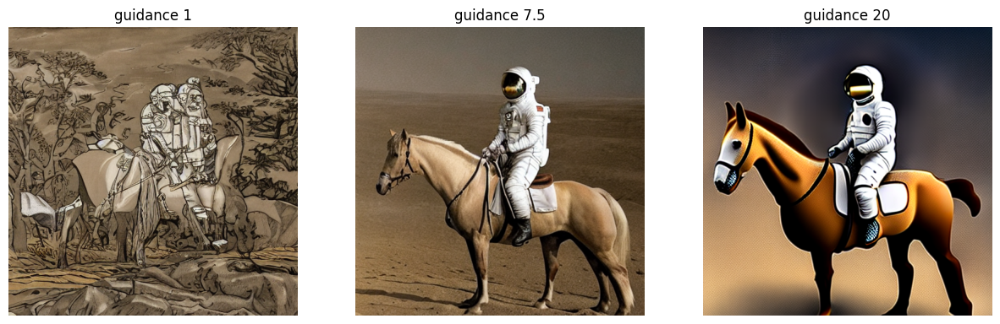

| guidance | 시간 | 결과 |
| --- | --- | --- |
| 1 | 4.53s | 연필 스케치 같음, 사람이 겹쳐 보이고 달 배경 없음 |
| 7.5 | 4.49s | 사실적인 사진 |
| 20 | 4.53s | 색 과하고 장난감·만화 같음 |

guidance가 크면 느려질 줄 알았는데 셋 다 시간이 같았음. 모델은 매 단계 예측을 두 번 함(프롬프트 있음 / 없음). guidance는 그 차이를 몇 배로 키울지만 정하는 값이라 계산량은 그대로임. 속도를 바꾸는 건 `num_inference_steps`임.

20이 오히려 사진에서 멀어진 건 차이를 너무 키워서 실제 사진 범위를 벗어났기 때문으로 보임. 이 차이는 픽셀이 아니라 latent에서 노이즈 예측에 곱해지는데, 20배로 밀면 매 단계 프롬프트 쪽으로 너무 크게 움직여서 색이 과하고 세부가 단순해지는 것으로 보임.

결함 프롬프트로 직접 해 본 건 아니지만, 결함 생성에도 같은 일이 생기면 균열이 과장되고 색과 대비가 세질 텐데, 실제 공장 균열은 대부분 가늘고 희미하니 그걸로 학습한 모델은 미탐을 낼 것 같음. 그래서 결함 생성에서도 기본값 근처(7.5~8.5)부터 시작하는 게 안전해 보임.

## 실험 A2. fp32 vs fp16

시드 42, guidance 7.5, steps 30에서 자료형만 바꿔서 시간과 최대 GPU 메모리를 잼.

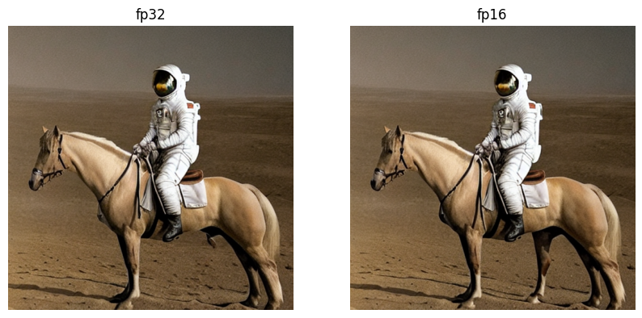

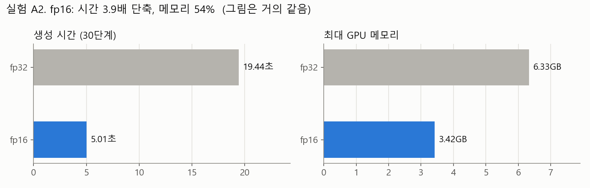

| | 시간 | 최대 GPU 메모리 | 그림 |
| --- | --- | --- | --- |
| fp32 | 19.44s | 6.33GB | |
| fp16 | 5.01s | 3.42GB | 거의 같음 |

메모리랑 시간이 줄어드는 건 예상대로였는데, 표현을 줄였으니 세부가 좀 뭉개질 거라는 예상은 틀림. 그림은 마지막에 픽셀마다 0~255 정수로 반올림돼서 저장됨. fp32가 127.53, fp16이 127.5를 내도 둘 다 128이 되니 소수점 아래 차이는 사라짐. 말 다리처럼 아주 조금 다른 곳은 30단계를 거치면서 작은 오차가 쌓인 걸로 보임.

속도가 2배가 아니라 3.9배 빨라진 건 T4에 fp16 전용 연산 장치(Tensor Core)가 있어서임. 노드 5 Quantization이랑 같은 얘기로, 숫자를 덜 정밀하게 써도 결과가 0~255로 저장되니 차이가 거의 안 남.

## 실험 A3. num_inference_steps 10 / 20 / 30 / 50

생성 모델은 학습을 하지 않으니 "몇 epoch에서 최적이었나" 대신 "몇 단계면 충분한가"를 봐야 함. 노트북은 30과 50을 그냥 쓰고 있었는데 근거가 없어서 확인함. 시드 42, guidance 7.5, fp16, 같은 프롬프트. (10-14 추가 실험)

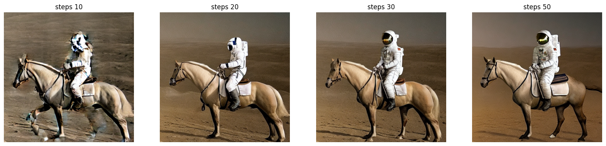

| steps | 시간 | 결과 |
| --- | --- | --- |
| 10 | 1.73s | 윤곽이 번지고 헬멧·얼굴이 뭉개짐, 말 다리도 번짐 |
| 20 | 3.11s | 구도와 형태가 다 잡힘, 헬멧은 어두운 실루엣 |
| 30 | 4.51s | 20과 구도 같음, 바이저 반사와 우주복 패치 같은 세부가 생김 |
| 50 | 7.59s | 구도 같음, 말 색과 다리 모양만 바뀌고 대비가 세짐 |

시간은 단계 수에 거의 비례함(10단계당 약 1.5초). guidance(A1)는 시간을 안 바꿨는데 steps는 그대로 시간을 늘림. 단계마다 UNet을 한 번씩 더 돌리기 때문임.

그림은 20에서 형태가 다 잡히고 30에서 세부가 채워졌음. 50은 30보다 나아졌다기보다 다른 그림이 됨. 20도 형태는 다 잡혀서 시간을 30%쯤 아끼려면 20도 고려했지만, 균열 결함을 만든다면 30으로 하겠음. 20→30에서 세부가 생겼고, 균열은 가늘고 작은 결함이라 20→30에서 생긴 세부 차이가 중요하다고 봄. 다만 그림 1장씩만 본 판단이라 주관적임.

## 회색판 Inpainting (강사 셀)

밝은 회색 단색 판에 가운데 흰 원 마스크를 두고 "A deep circular dent with rough edges"로 생성하는 셀.

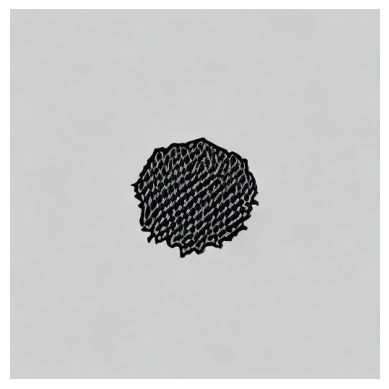

판이 단색이라 찌그러짐이 제대로 안 나올 거라고 예상했고 그대로 됨. 결과는 판에 스티커처럼 붙은 검은 얼룩이고 움푹 들어간 느낌이 없음.

회색판에는 빛(그림자, 어느 쪽에서 비추는지)과 재질(금속은 날카롭게 반사, 플라스틱은 흐릿하게, 종이는 접힘) 정보가 없음. Inpainting은 마스크 바깥의 빛과 재질을 단서로 안을 채우는데, 단색 판에는 단서가 없음. 강사도 셀 끝 TODO에 "실제 정상 제품 이미지에 마스크 적용"을 남겨 둠.

실제 사진(강사 셀, 해변)으로 바꾸면 보물 상자에 그림자가 생기고 파도가 상자를 감쌈. 상자 색이 바다를 따라 청록색이 된 것도 주변을 단서로 쓴다는 걸 보여 줌.

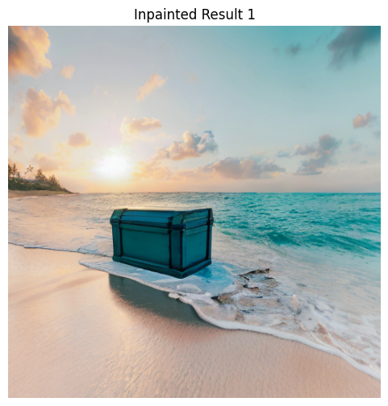

## 실험 B1. 실제 PCB에 crack Inpainting

정상 PCB 가운데에 작은 직사각형 마스크를 두고 "a crack on the circuit board, broken trace", steps 50, guidance 7.5로 생성함.

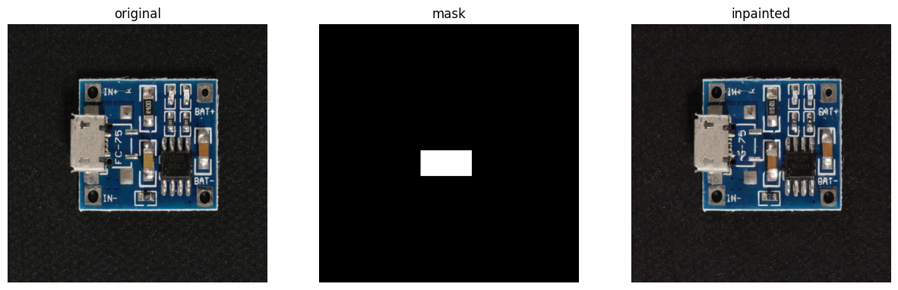

실제 PCB 사진을 썼으니 회색판보다는 그럴듯할 거라고 예상함. 사진 전체는 진짜 PCB처럼 자연스러웠지만, 마스크 안에 균열은 거의 안 생겼고 마스크 바깥 글자까지 바뀜.

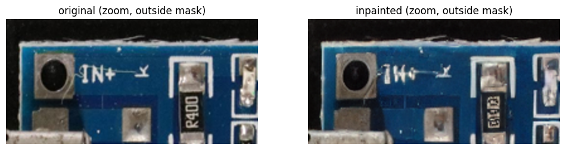

글자가 바뀐 건 사진 전체가 VAE로 64×64 latent로 압축됐다가 복원되기 때문임. 마스크는 latent에서 어디를 다시 그릴지만 정하고, 바깥도 압축·복원은 똑같이 거침. 가로세로 8배 압축이라 작은 인쇄 글자는 그대로 돌아오지 않음. 노드 6 슬라이드에서 AutoEncoder가 압축하면 세부가 사라진다고 한 것과 같은 원리로 보임.

균열이 안 생긴 건 SD가 PCB 균열을 거의 본 적이 없어서로 보임. 처음엔 "정상 데이터로만 학습해서"라고 생각했는데 그건 PaDiM 얘기임. SD는 인터넷 사진 수십억 장으로 학습해서, 말 탄 우주인이나 해변의 상자는 많이 봤지만 PCB 기판의 미세 균열 근접 사진은 거의 못 봤을 것임.

## 실험 B2. 마스크 바깥에 원본 픽셀 되붙이기

B1 결과에서 마스크 바깥을 원본 픽셀로 되돌림.

```python
m3 = (np.array(mask.resize(out.size)) / 255.0)[..., None]
comp = out * m3 + init * (1 - m3)    # 마스크 안은 생성, 바깥은 원본
```

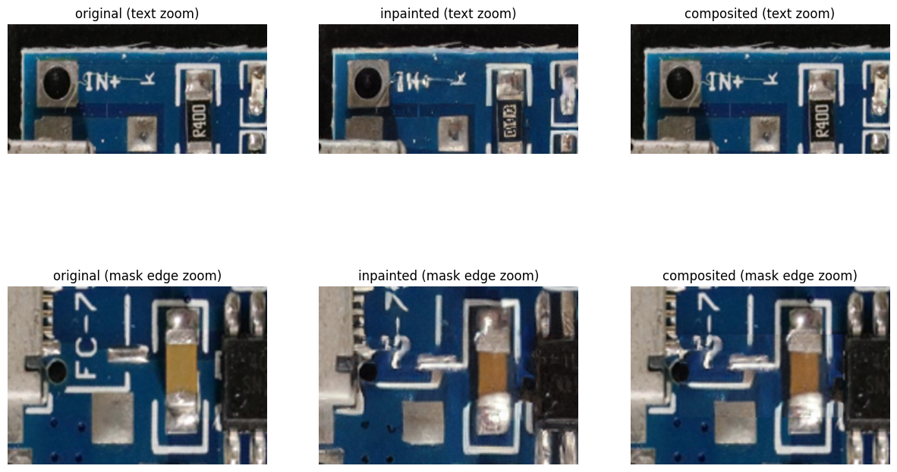

글자는 원본대로 돌아오고 경계가 어색할 거라고 예상했는데 둘 다 맞음. `IN+`, `R400`은 원본 그대로 돌아왔지만, 마스크 경계에서 `FC-75` 글자가 반은 원본, 반은 생성으로 직선으로 잘려 이어지고 배선도 끊김.

이 이음새는 실제 불량에는 없는 흔적임. 이 사진에 불량 라벨을 붙이면 모델이 균열 대신 직선 이음새를 불량의 특징으로 배울 수 있음. 경계를 흐리게 섞으면(feathering) 줄어들 것 같음.

## AnomalyAny 결과 분석 (8-2 강사 출력)

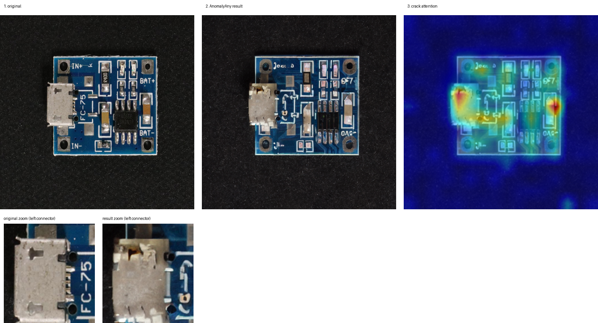

왼쪽부터 원본 / AnomalyAny 결과 / "crack" 단어의 attention map, 아래는 왼쪽 USB 커넥터 확대.

AnomalyAny도 모델은 8-1과 같은 SD 1.5이고 추가 학습도 없음. 바뀌는 건 생성 과정임. 매 단계 "crack" 단어(프롬프트의 8번 토큰, 코드의 `tokens = "8"`)의 attention을 보고, 어디에서도 약하면 기울기를 계산해서 latent를 crack이 강해지는 쪽으로 밂(Attend-and-Excite). 동시에 `init_image_guidance_scale`로 원본에서 너무 멀어지지 않게 붙잡음.

작은 글자와 부품은 잘 남을 거라고 예상했는데 틀림. 글자가 `IN+` → `Joa d`, `BAT+` → `97`, `BAT-` → `OAS`로 바뀜.

10-07에는 기판 위에서만 균열을 찾다가 균열은 거의 안 보인다고 적었음. 10-10에 attention map과 나란히 놓고 보니 빨간 곳이 왼쪽 USB 커넥터였고, 확대하면 커넥터 윗부분이 찢어지고 갈라져 있었음. 균열을 실제로 생성한 것이었음.

커넥터에 그려진 건, 모델이 PCB 기판 균열은 거의 못 봤어도 금속이 찢어진 사진은 많이 봤기 때문으로 보임.

그런데 이건 4장 중 첫 장 얘기라서, 나머지 3장도 같은 식으로 봤음.

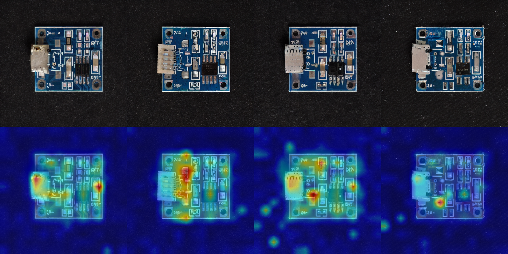

| | 결과 사진 | attention이 강한 곳 |
| --- | --- | --- |
| 1 | 커넥터 윗부분이 찢어지고 갈라짐 | 커넥터, 오른쪽 가장자리 |
| 2 | 커넥터가 다른 핀 커넥터로 바뀜, 균열은 안 보임 | 커넥터 오른쪽 부품 |
| 3 | 커넥터 모양이 바뀜, 뚜렷한 균열은 없음 | 커넥터 아래 부품 |
| 4 | 기판에 흰 얼룩이 생김 | 그 얼룩 자리 |

4장 모두 attention이 모인 자리가 실제로 바뀌었고 대부분 커넥터 주변이었음. 하지만 균열처럼 보이는 건 1장뿐이고, 나머지는 부품이 바뀌거나 얼룩이 생김. crack을 억지로 밀어도 모델은 자기가 아는 범위 안에서 "뭔가 이상한 변화"로 바꿔 그리는 것 같음. "본 적 없는 결함을 만든다"기보다는 아는 변화를 처음 보는 물체에 붙인 것에 가까움.

두 번째로 빨간 오른쪽 점에서는 `BAT+` 아래 주황 부품이 은색으로 바뀜. 균열 대신 색이 바뀐 것임.

이 사진에 "crack" 라벨을 붙여서 학습하면 문제가 생길 것 같음. 정상 사진은 글자가 선명하고 생성한 불량은 글자가 뭉개져 있으니, 모델 입장에서는 작은 커넥터 균열보다 "글자가 뭉개졌나"가 훨씬 쉬운 구분 기준임(지름길 학습). 그러면 글자가 선명한 진짜 균열 PCB가 들어왔을 때 정상으로 판정함(미탐). 슬라이드 p.26에 "생성된 결함의 현실성 검증 필요"라고 한 게 이런 경우로 보임.

## 실험 C1. AnomalyAny `init_image_guidance_scale` 0.3 vs 0.7 → T4에서 실행 불가

같은 시드(1234)로 원본 충실도 0.3과 0.7을 비교하려 함. 0.7이면 글자와 부품은 원본을 따르고 균열은 약해질 거라고 예상함.

비교까지 가지 못함. 세션을 새로 시작한 T4에서 강사 원본 셀도 0/200단계에서 OOM이 남(프로세스 14.16GiB 사용 중 1GiB 요청 실패). 강사는 서버 GPU에서 돌린 노트북으로 보임.

디버깅 기록:

| # | 증상 | 원인 | 조치 |
| --- | --- | --- | --- |
| 1 | `stabilityai/stable-diffusion-2-inpainting` 401 (8-1) | Hub 저장소가 내려감 | `AutoPipelineForInpainting`으로 SD1.5 계열 후보를 차례로 시도 → `runwayml/stable-diffusion-inpainting` |
| 2 | `No module named 'clip'` | AnomalyAny `clip_loss.py`가 쓰는데 강사 설치 셀에 없음 | `pip install ftfy regex git+https://github.com/openai/CLIP.git` |
| 3 | `No module named 'pyrallis'` | 마찬가지로 설치 셀에 없음 (강사 서버엔 이미 설치) | 세션 재시작 후 빠진 모듈 설치 |
| 4 | `%load_ext autoreload` → `No module named 'imp'` | Python 3.12에서 `imp` 제거 | 개발 편의 기능이라 무시. AnomalyAny import는 성공 |
| 5 | `CUDA out of memory` | 아래 표 | 해상도 → fp16 → autocast 순으로 시도, 장비 한계로 결론 |

OOM을 줄이려고 한 시도:

| 시도 | 가설 | 결과 |
| --- | --- | --- |
| 해상도 768 → 512 | 슬라이드 p.20 "해상도가 높을수록 VRAM" | 같은 숫자로 OOM(이 출력은 나중에 셀을 다시 돌리면서 덮어써짐). 코드를 보니 생성 크기는 `unet.sample_size × vae_scale_factor = 512` 고정이고 입력은 안에서 512로 줄임. 해상도는 원인이 아니었음 |
| fp16 로드 | p.20 Precision 변환 | 로드 후 2.16GB로 줄었지만 `mat1 and mat2 must have the same dtype, but got Float and Half`. AnomalyAny 내부가 fp32 입력을 만듦. 정밀도는 코드 전체를 같이 맞춰야 함(노드 5) |
| fp32 모델 + 생성만 `torch.autocast` | 중간 계산만 16비트로 | 실패한 요청이 1024 → 512MiB로 절반이 됐지만 프로세스 사용 14.43GiB(PyTorch 할당 14.05GiB)라 OOM |

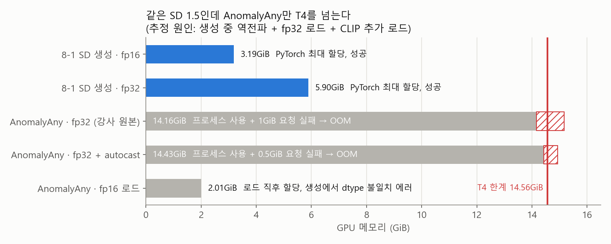

(8-1은 `max_memory_allocated() / 1e9`로 잰 PyTorch 할당량(GB)이라 GiB로 바꿔 그림(3.42GB = 3.19GiB). AnomalyAny 행은 OOM 메시지의 프로세스 사용량. 프로세스 사용량에는 CUDA 기본 메모리가 더 들어가서, 8-1 실제 사용량은 그림보다 조금 더 큼)

같은 SD 1.5인데 8-1(fp16 3.42GB)과 달리 15GB로도 모자란 이유는 세 가지로 봄.

1. 역전파: crack을 밀려면 기울기가 필요하고, 기울기를 구하려면 앞으로 계산한 중간값을 GPU에 들고 있어야 함. 생성인데 학습처럼 메모리를 씀.
2. fp32 로드: 강사 모델 로드 셀에 `torch_dtype`이 없음.
3. CLIP 추가 로드: 호출마다 `clip.load("ViT-L/14")`로 큰 모델을 하나 더 올림.

T4에서 돌리려면 AnomalyAny 코드를 fp16에 맞게 고치거나 더 큰 GPU(L4 24GB, A100 40GB)가 필요함. C1 비교 대신 강사 출력을 분석함.

> 노트북의 C1 셀 3개에는 각 셀을 마지막으로 실행한 결과가 남아 있음. 첫 셀은 768 fp32 OOM, 두 번째 셀은 fp16 로드 뒤 다시 실행해서 dtype 에러, 세 번째 셀은 autocast OOM. 512 재시도의 OOM 출력은 덮어써짐.

---

> 숫자와 그림은 제출 노트북 셀 출력에서 옮김. 모든 실험은 1번씩 돌림. AnomalyAny 그림은 강사가 남긴 출력이라 시드를 알 수 없음.
