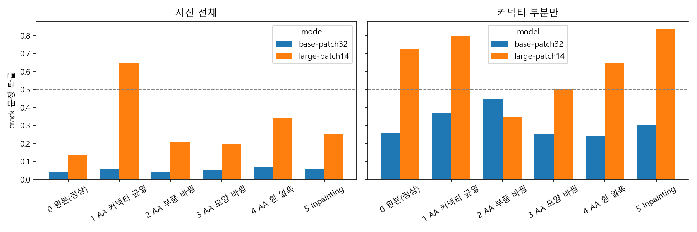
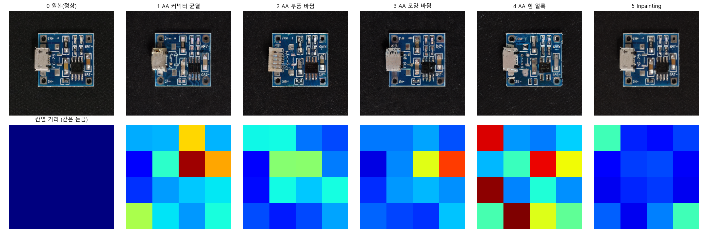

# SlowPaper: CLIP 다시 읽기

*Learning Transferable Visual Models From Natural Language Supervision* (Radford et al., OpenAI, 2021)
[arXiv 2103.00020](https://arxiv.org/abs/2103.00020)

10-08 수업에서 함께 읽은 CLIP 논문을 다시 읽고 다섯 가지 질문에 답한 뒤, 노드 8에서 남은 의문을 CLIP으로 직접 확인한 회고입니다.

> 모두의연구소 AX Bootcamp · 컴퓨터 비전 · SlowPaper

## 1. 왜 이 논문을 선택했는가

수업에서 함께 읽은 논문이라 골랐는데, 다시 읽다 보니 노드 8 실습에서 이미 쓰고 있던 부품이었다.

- Stable Diffusion은 프롬프트를 CLIP의 텍스트 인코더로 읽는다. "a crack on the circuit board"가 그림이 되는 첫 단계가 CLIP이었다.
- AnomalyAny 노트북의 `tokens = "8"`은 CLIP 토크나이저가 단어에 붙인 번호였고("crack"), `No module named 'clip'` 에러는 AnomalyAny가 결함이 프롬프트와 맞는지 CLIP으로 확인하기 때문에 난 것이었다.

에러를 고치면서 이름만 봤던 부품이 무엇을 하는지 알고 싶었다.

## 2. 어떤 연구 분야인가

이미지와 글을 함께 다루는 **Vision-Language** 분야이고, 방법은 **대조 학습(Contrastive Learning)** 이다.
사람이 단 라벨 대신 사진에 원래 붙어 있던 글을 정답으로 쓰는 **Natural Language Supervision**,
학습 없이 새 작업에 바로 옮겨 쓰는 **Zero-shot transfer**가 핵심 단어다.

## 3. 어떤 문제가 있었는가

기존 비전 모델은 정해진 클래스 목록만 맞히도록 학습한다. 맨 끝 층의 출력 칸 수가 고정되어 있다(static softmax classifier).

공장으로 바꿔 보면, PCB 결함 분류기를 정상 / 균열 / 긁힘 3개로 학습했는데 "납땜 누락"이라는 새 결함이 생기면
모델은 그 사진을 셋 중 하나로 판정해 버린다. 알아보게 하려면 납땜 누락 사진을 모아 라벨을 달고 다시 학습해야 하고,
새 결함이 생길 때마다 이 비용이 반복된다.

논문은 그동안의 시도를 이렇게 정리한다.

| 방식 | 예 | 한계 |
| --- | --- | --- |
| 사람이 단 라벨 | ImageNet (클래스 1000개) | 라벨링 비용 때문에 데이터를 늘리기 어려움 |
| 대충 붙은 라벨 | 인스타그램 해시태그, JFT-300M | 데이터는 많지만 클래스 목록이 고정 (1000개, 18291개) |
| 글에서 직접 배우기 | VirTex, ConVIRT, Li et al. (2017) | 규모가 10~20만 장으로 작고, 제로샷 ImageNet 11.5% |

CLIP은 두 번째의 규모와 세 번째의 유연함을 합치려는 시도다.

## 4. 그 문제를 어떻게 해결했는가

**데이터**: 인터넷에서 이미지-글 쌍 4억 개(WIT)를 모았다. 글은 원래 사진에 붙어 있던 설명이나 제목이라
사람이 라벨을 달 필요가 없었고, 그래서 ImageNet의 300배 넘게 모을 수 있었다.

**과제를 쉽게 바꿈**: 처음엔 사진을 보고 붙어 있던 글을 단어 그대로 맞히게 했는데, 같은 사진에도 별별 글이 붙어 있어서
학습이 느렸다. 대신 "이 글 묶음 중에 이 사진의 짝이 어느 것이냐"만 맞히게 바꿨더니 같은 정확도에 4배 빨리 도달했다(Figure 2).

**학습 방식** (Figure 1, Figure 3의 의사코드):

```
          글1   글2   글3   글4
사진1    [짝]   ✗     ✗     ✗
사진2     ✗   [짝]    ✗     ✗
사진3     ✗     ✗   [짝]    ✗
사진4     ✗     ✗     ✗   [짝]
```

1. 이미지 인코더(ResNet, ViT)와 텍스트 인코더(Transformer)가 사진 N장, 글 N개를 각각 벡터로 바꾼다.
2. 모든 사진-글 조합의 코사인 유사도로 N×N 표를 만든다.
3. 대각선(진짜 짝)은 높이고 나머지(가짜 짝, N²−N개)는 낮추도록 cross entropy를 사진 쪽, 글 쪽에서 한 번씩 계산해 평균 낸다.

실제 배치 크기는 32,768이라 한 묶음에 가짜 짝이 약 10억 개다. 묶음이 크면 "골든 리트리버"와 "래브라도"처럼
헷갈리는 상대가 같이 들어오고, 그걸 구분하려면 개 품종 수준의 세밀한 차이까지 배워야 한다. 큰 배치가 유리한 이유로 이해했다.

처음엔 이게 글을 학습하는 건지 사진을 학습하는 건지 헷갈렸는데, 두 인코더를 동시에 학습해서 둘 사이의 관계를 배우는 것이었다.
학습이 끝나면 강아지 사진과 "a photo of a dog"가 같은 공간의 가까운 자리에 놓인다. 둘을 따로 떼어 쓸 수도 있어서,
Stable Diffusion은 텍스트 인코더만 가져다 썼다.

**학습 없이 분류하기 (zero-shot)**: 클래스마다 "A photo of a {label}." 문장을 만들어 벡터로 바꾸고,
사진 벡터와 가장 가까운 문장을 고른다. 클래스를 추가하고 싶으면 문장을 하나 더 쓰면 된다.
3번의 납땜 누락 문제라면, 정답 붙은 결함 사진 없이 문장 4개와 분류할 사진만 있으면 된다.

## 5. 시도한 결과는 어떠한가

| 결과 | 숫자 |
| --- | --- |
| 제로샷 ImageNet | 이전 연구 11.5% → CLIP 76.2% (128만 장으로 학습한 원래 ResNet-50과 같은 수준) |
| 문장 템플릿 "A photo of a {label}." | 단어만 쓸 때보다 +1.3% |
| 문장 80개 앙상블 | 추가 +3.5%, 합쳐서 약 +5% |
| 분포가 바뀐 데이터 (그림, 스케치 등) | ImageNet 대비 정확도 손실을 최대 75% 줄임 (Figure 13) |

가장 기억에 남는 건 강건성이다. 같은 바나나를 그림, 스케치, 캐릭터로 바꿔도 CLIP은 버텼다.
처음엔 "문장이 남아 있어서"라고 생각했는데, 논문의 설명은 CLIP이 시험 데이터셋으로 학습하지 않아서
그 데이터셋에만 있는 우연한 패턴을 외울 수 없었다는 것이었다. 노드 6에서 학습 때 뒤집기를 켰더니
그 변형까지 외워서 성능이 떨어졌던 것과 같은 이야기로 보였다.

**한계도 분명하다** (6장).

- 자동차 모델, 꽃 품종 같은 세밀한 구분과 물체 개수 세기 같은 추상적 작업에 약하다.
- 처음 보는 종류의 데이터에는 거의 찍기 수준이다. 손글씨 숫자 MNIST에서 88%로, 픽셀에 로지스틱 회귀를 돌린 것보다 낮다.
  4억 장 안에 MNIST 같은 사진이 거의 없었기 때문이다.
- 각 분야 최고 성능까지 가려면 연산이 약 1000배 더 필요하다고 추정한다.

## 6. 내 생각: 공장 PCB 결함에 쓴다면

제로샷으로는 잘 안 될 것 같다. 노드 8에서 Stable Diffusion이 PCB 균열을 거의 못 그린 것과 같은 이유로,
인터넷에 PCB 결함 사진과 설명 글 쌍이 현저히 모자라서 MNIST처럼 CLIP에게는 처음 보는 데이터에 가깝다.

보완한다면 결함 사진 몇 장에 설명 문장을 붙여 PCB용 이미지-글 쌍을 만들고 CLIP을 조금 더 학습시키는 방법이 있다.
다만 사진이 적으면 그 몇 장을 외워 버릴 수 있어서, CLIP은 그대로 두고 이미지 특징 위에 작은 분류기만 학습하는
few-shot linear probe(논문 3.1.5장)와 비교해 봐야 할 것 같다.

문장을 쓸 때도 조심해야 한다. 논문에서 "crane"이 학인지 크레인인지 헷갈렸듯이, 납땜이 옆 핀까지 이어진 불량을
"bridge"라고만 쓰면 다리로 읽힐 수 있다. "a photo of a printed circuit board with a solder bridge between pins"처럼 맥락을 붙여야 한다.

## 7. 직접 해 본 실험: CLIP은 생성된 결함을 "균열"로 볼까

노드 8에서 AnomalyAny는 CLIP(ViT-L/14)으로 "생성한 결함이 crack이라는 글과 맞는지" 점수를 매기며 그림을 밀었다.
그런데 사람 눈에는 균열 모양이 4장 중 1장뿐이었다. 같은 CLIP으로 그 사진들을 다시 채점해 봤다.
(코드와 출력: [`clip_generated_defects.ipynb`](clip_generated_defects.ipynb), 로컬 CPU, 학습 없음)

- 사진 6장: 0 원본 정상 PCB / 1~4 AnomalyAny 강사 출력(1번만 커넥터 균열, 2 부품 바뀜, 3 모양 바뀜, 4 흰 얼룩) / 5 노드 8-1 Inpainting(crack 지시)
- 모델: ViT-L/14(AnomalyAny가 쓰는 것), ViT-B/32 / 사진 전체와 커넥터만 잘라 낸 것

### 7-1. 처음 실험: 문장 한 쌍으로 묻기

"a photo of a normal printed circuit board" vs "a photo of a printed circuit board with a crack" 중 crack 쪽 확률을 봤다.



| 사진 | ViT-L/14 전체 | ViT-L/14 커넥터만 |
| --- | ---: | ---: |
| 0 원본(정상) | 0.133 | 0.724 |
| 1 커넥터 균열 | **0.649** | 0.799 |
| 2 · 3 · 4 | 0.205 / 0.195 / 0.340 | 0.347 / 0.501 / 0.649 |
| 5 Inpainting | 0.252 | 0.839 |

돌리기 전 예상(1번이 가장 높고, 커넥터만 자르면 더 높고, 2·3·4번도 원본보다 높다)은 숫자로는 다 맞았다.
작은 ViT-B/32는 사진 전체에서 6장 모두 0.04~0.07이라 아무것도 구분하지 못했다.

처음엔 "CLIP도 사람처럼 1번만 균열로 봤고, 커넥터 확대 사진은 4억 장 안에 없어서 정상도 균열로 봤다"고 정리했다.
그런데 두 가지가 걸렸다. 모델이 제대로 작동하는지 확인하지 않았고, 잘라 낸 커넥터는 PCB처럼 안 보이는데 문장은 PCB 문장뿐이었다.

### 7-2. 확인: 모델은 정상인가, 문장을 바꾸면?

- **작동 확인**: "PCB / USB 커넥터 / 강아지 / 자동차 / 바나나" 중 고르게 하니 강아지·자동차·바나나는 모든 사진에서 0이었다.
  1번 전체는 PCB 0.951, 0번 커넥터 확대는 USB 커넥터 0.913으로 맞게 봤다. 모델은 제대로 작동한다. 다만 0번 원본 전체는 PCB가 아니라 USB 커넥터(0.908)로 봤고, 1번 커넥터 확대는 PCB 0.461 / USB 커넥터 0.539로 반반이었다.
- **문장 바꾸기**: 커넥터 사진에 커넥터에 맞는 문장 쌍 3개를 더 줬다.

| 커넥터 crack 확률 | PCB 문장(처음) | 커넥터 문장 1 | 커넥터 문장 2 | 커넥터 문장 3 |
| --- | ---: | ---: | ---: | ---: |
| 0 원본(정상) | 0.724 | 0.551 | 0.774 | 0.959 |
| 1 커넥터 균열 | 0.799 | 0.868 | 0.704 | 0.944 |

커넥터에 맞는 문장으로 바꾸면 원본의 균열 확률이 올라갈 거라고 예상했는데, 문장 2·3에서는 올랐고 1에서는 내렸다.
더 큰 문제는 문장 2·3에서 정상 원본이 오히려 균열 사진보다 높았다는 것이다. 사진 전체에서도 문장 2를 쓰면 원본(0.682)이 1번(0.544)보다 높았다.
"CLIP도 1번만 균열로 봤다"는 문장 4쌍 중 2쌍에서만 성립했다.

### 7-3. 왜 이렇게 흔들리나

CLIP 확률은 코사인 유사도에 100(학습된 온도)을 곱해 softmax한 값이다. 유사도 원래 값을 보니:

| 사진 | 정상 문장 | 균열 문장 | 차이 | 확률 |
| --- | ---: | ---: | ---: | ---: |
| 0 원본 커넥터 | 0.2528 | 0.2625 | 0.0096 | 0.724 |
| 1 균열 커넥터 | 0.2564 | 0.2702 | 0.0138 | 0.799 |

차이가 클 거라고 예상했는데, 12개 경우 모두 0.02보다 작았다. 두 문장 모두 사진과 비슷하게 애매하게 맞았고,
그 아주 작은 차이가 ×100으로 부풀려져 0.72 같은 확률이 됐다. CLIP이 균열이라고 확신한 게 아니라 사실상 동전 던지기였다.
문장을 조금만 바꿔도 결과가 뒤집힌 이유도 이것으로 보인다.

CLIP은 PCB와 USB 커넥터 자체는 잘 알아봤으니, 모자랐던 건 PCB 사진보다 "결함 사진 + 그 결함을 설명한 글" 쌍이었던 것 같다.
다만 학습 데이터(WIT)는 공개되지 않아서 논문이 MNIST로 한 것처럼 직접 검색해 확인할 수는 없다. 추측이다.

### 7-4. 성능 올려 보기

**문장 앙상블** (논문 3.1.4장): 문장 틀 5개 × 정상 표현 4개 / 균열 표현 4개, 클래스당 20문장을 평균 냈다.

| 앙상블 crack 확률 | 전체 | 커넥터 |
| --- | ---: | ---: |
| 0 원본(정상) | **0.265 (최저)** | **0.539 (최저)** |
| 1 커넥터 균열 | **0.544 (최고)** | **0.753 (최고)** |
| 2 · 3 · 4 · 5 | 0.33 ~ 0.41 | 0.56 ~ 0.70 |

평균을 내면 더 흔들릴 거라고 예상했는데 반대였다. 문장 한 쌍으로는 순위가 뒤집혔지만, 20문장 평균은 전체와 커넥터 모두
원본이 가장 낮고 1번이 가장 높아서 사람 눈과 같은 순서가 됐다. 문장마다의 우연한 흔들림이 평균으로 상쇄된 것으로 보인다.

**정상 사진과 비교** (노드 6 이상탐지처럼): 글 대신 원본의 CLIP 이미지 특징과 얼마나 다른지(1 − 코사인)를 쟀다.
사진 전체로 보면 예상대로 1번이 가장 멀었다(0.081). 글자만 바뀐 Inpainting이 가장 가까웠다(0.024).

PaDiM처럼 사진을 16칸으로 나눠 같은 자리끼리 비교하기도 했는데, 이건 쓸 수 없었다.



1번에서 가장 다른 칸이 커넥터가 아니라 오른쪽 위였고, 4번은 가장자리 칸이 빨갰다. AnomalyAny가 만든 사진은 PCB 위치가
원본과 조금씩 어긋나 있어서, 칸끼리 비교하면 결함이 아니라 위치가 밀린 것을 잰다. 노드 6에서 위치에 기대는 PaDiM이
뒤집기에 약했던 것과 같은 이유다. 칸별로 비교하려면 먼저 정렬을 맞춰야 한다.

### 7-5. 정리

- 이 사진들에 대한 CLIP의 균열 판단은 문장 한 쌍으로 물으면 순위가 뒤집힐 만큼 불안정하다. 확률이 0.7~0.9로 높아 보여도 유사도 차이는 0.01 수준이었다.
  그래서 생성한 결함을 CLIP 점수 하나로 검증하면 안 된다. AnomalyAny가 crack을 밀었을 때 균열 대신 부품 교체나 얼룩이 나온 것도, 이렇게 애매한 신호를 보며 밀었기 때문일 수 있다.
- 문장 20개 앙상블로는 순위가 안정돼서 사람 판단과 같아졌다. ImageNet에서는 앙상블이 정확도를 몇 % 올리는 정도였는데, 처음 보는 PCB 사진에서는 순위를 바로잡을 만큼 중요했다.
- 사진 6장, 정상 1장으로 1번씩 돌린 작은 실험이라 숫자 자체보다 경향으로 봐야 한다.

## 구조

```
.
├── README.md                      이 문서
├── clip_generated_defects.ipynb   7번 실험 (CLIP으로 생성 결함 채점)
└── images/                        실험에 쓴 사진 6장과 결과 그래프
```

## 회고

**Keep**

- 논문 내용을 실습에서 본 것과 연결해서 읽은 것. SD 텍스트 인코더, `tokens = "8"`, `clip` 모듈 에러가 다 CLIP이었다는 걸 알고 나니 논문이 남의 이야기가 아니게 됐다.
- 개념마다 공장 상황(납땜 누락, PCB 결함 제로샷)에 대입해서 확인한 것.
- 읽고 끝내지 않고, 노드 8에서 남은 의문("CLIP은 생성한 결함을 균열로 봤을까")을 실제로 돌려서 확인한 것. 돌리기 전에 예상을 먼저 적었다.
- 첫 결과를 그대로 믿지 않고 작동 확인, 문장 바꾸기, 유사도 원래 값까지 다시 본 것. 그 과정에서 논문 3.1.4장(문장을 잘 써야 한다, 앙상블)이 왜 중요한지 직접 알게 됐다.

**Problem**

- 수업에서 함께 읽었는데 일주일 만에 거의 기억이 나지 않았다. 듣기만 하고 내 말로 정리하지 않았다.
- 제로샷에 필요한 준비물을 학습 데이터(사진-글 쌍)와 헷갈렸다. 학습된 CLIP을 쓸 때는 문장과 분류할 사진만 있으면 된다.
- 강건성의 이유를 "문장이 남아 있어서"로만 생각했다.
- 처음 실험 결과를 보고 "CLIP도 1번만 균열로 봤다", "PCB 확대 사진이 4억 장에 없어서"라고 바로 결론 냈다. 모델이 제대로 작동하는지, 문장을 바꿔도 같은지 확인하지 않은 상태였다. 확인해 보니 문장에 따라 순위가 뒤집혔고 원인도 추측이었다.
- 유사도 차이가 클 거라고, 앙상블은 더 흔들릴 거라고 예상했는데 둘 다 반대였다. 확률 숫자만 보고 CLIP이 확신한다고 착각했다.

**Try / Action**

- [ ] 7-4의 칸별 비교를 사진 정렬(위치 맞추기) 뒤에 다시 해서, 1번에서 가장 다른 칸이 커넥터 자리로 나오는지 확인한다.
- [ ] 노드 6의 VisA pcb4 정상 사진 여러 장을 기준으로 삼아, 정상 1장이 아니라 정상 분포와의 거리로 채점해 본다(PaDiM과 같은 방식에 CLIP 특징만 바꾸기).
- [ ] 공개 데이터셋 LAION에서 "cracked USB connector" 같은 문장으로 사진을 검색해, 결함 사진-글 쌍이 실제로 얼마나 드문지 확인한다.
- [ ] 다음 주 프로젝트(HF 비전 모델 + 에이전트)에서 "이 사진에서 균열 찾아 줘" 같은 명령을 받을 때, 모델을 고르는 단계에 CLIP 유사도를 쓸 수 있는지 검토한다.

---

# Peer Review Templete
- 코더 : 윤세훈
- 리뷰어 : 리뷰어의 이름을 작성하세요.

# PRT(Peer Review Template)
- [ ]  **1. 주어진 문제를 해결하는 완성된 코드가 제출되었나요?**
	- 문제에서 요구하는 최종 결과물이 첨부되었는지 확인
		- 중요! 해당 조건을 만족하는 부분을 캡쳐해 근거로 첨부
    
- [ ]  **2. 전체 코드에서 가장 핵심적이거나 가장 복잡하고 이해하기 어려운 부분에 작성된 
주석 또는 doc string을 보고 해당 코드가 잘 이해되었나요?**
	- 해당 코드 블럭을 왜 핵심적이라고 생각하는지 확인
	- 해당 코드 블럭에 doc string/annotation이 달려 있는지 확인
	- 해당 코드의 기능, 존재 이유, 작동 원리 등을 기술했는지 확인
	- 주석을 보고 코드 이해가 잘 되었는지 확인
		- 중요! 잘 작성되었다고 생각되는 부분을 캡쳐해 근거로 첨부
        
- [ ]  **3. 에러가 난 부분을 디버깅하여 문제를 해결한 기록을 남겼거나
새로운 시도 또는 추가 실험을 수행해보았나요?**
	- 문제 원인 및 해결 과정을 잘 기록하였는지 확인
	- 프로젝트 평가 기준에 더해 추가적으로 수행한 나만의 시도, 
	실험이 기록되어 있는지 확인
		- 중요! 잘 작성되었다고 생각되는 부분을 캡쳐해 근거로 첨부
        
- [ ]  **4. 회고를 잘 작성했나요?**
	- 주어진 문제를 해결하는 완성된 코드 내지 프로젝트 결과물에 대해
	배운점과 아쉬운점, 느낀점 등이 기록되어 있는지 확인
	- 전체 코드 실행 플로우를 그래프로 그려서 이해를 돕고 있는지 확인
		- 중요! 잘 작성되었다고 생각되는 부분을 캡쳐해 근거로 첨부
        
- [ ]  **5. 코드가 간결하고 효율적인가요?**
	- 파이썬 스타일 가이드 (PEP8) 를 준수하였는지 확인
	- 코드 중복을 최소화하고 범용적으로 사용할 수 있도록 함수화/모듈화했는지 확인
		- 중요! 잘 작성되었다고 생각되는 부분을 캡쳐해 근거로 첨부

# 리뷰어 회고(참고 링크 및 코드 개선 제안)
	# 리뷰어의 회고를 작성합니다.
	# 코드 리뷰 시 참고한 링크가 있다면 링크와 간략한 설명을 첨부합니다.
	# 코드 리뷰를 통해 개선한 코드가 있다면 코드와 간략한 설명을 첨부합니다.
