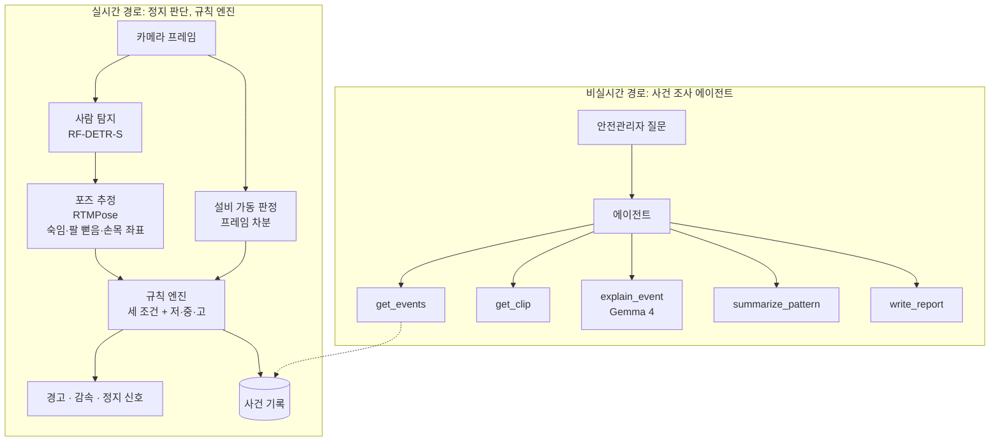
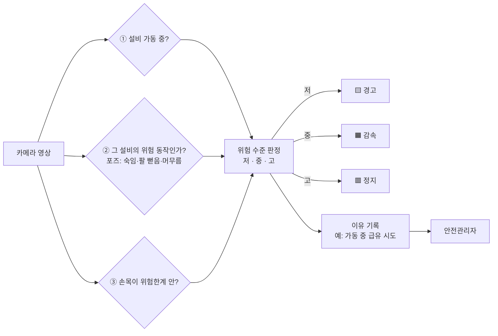

# OmniGuard AI PR/FAQ

> 모든 수치에는 출처 각주를 붙였습니다. ⚠️ 표시는 원문으로 확인하지 못했거나 팀이 정한 목표·설계값입니다. "(가상)"은 PR/FAQ 형식에 따른 가상의 미래 인터뷰입니다.

---

## Part 1: 프로젝트 기본 정보

| 항목       | 내용                                                                 |
| -------- | ------------------------------------------------------------------ |
| 프로젝트명    | OmniGuard AI: 기계를 켠 채 손을 넣는 순간만 골라 멈추는 카메라                         |
| 작성자      | 윤세훈 (PM)                                                           |
| 작성일      | 2026-10-15                                                         |
| 핵심 타겟 고객 | 50인 미만 식품·제조 공장의 안전관리자 (2순위: 사업주, 현장 작업자)                          |
| 영향 범위    | 끼임 위험 설비의 정비·청소·급유 작업. 1단계는 컨베이어                                   |
| 예상 런칭일   | 2026-10-22 PoC 시연(1단계) → 2027-03-02 파일럿 → 2027-06-01 정식 출시 ⚠️ 팀 계획 |
| 문서 상태    | 초안                                                                 |

---

## Part 2: Press Release

### 헤드라인
**OmniGuard AI, 카메라 한 대로 "기계를 켠 채 정비하는 순간"만 골라 멈춰, 생산을 세우지 않고 끼임 위험을 막았다**

### 리드 문단
[서울, 2027년 6월 1일] - OmniGuard AI 팀이 **50인 미만 식품·제조 공장 안전관리자**가 겪던 **"기계를 켠 채 정비하다 끼이는 사고를 미리 막을 방법이 없는 문제"**를 해결하는 **OmniGuard AI**를 출시했다. 설비 옆 카메라 한 대가 작업자의 자세와 손목 위치를 읽어, 기계가 돌아가는 중에 손이 위험한 곳으로 들어가는 순간에만 설비를 멈춘다. 출시 전 검증에서 **시험 장면 8개에 모두 정해진 단계로 반응했고, 지나가기만 한 사람에게 잘못 멈춘 경우는 0건이었으며, 위험 감지부터 정지 신호까지 0.3초 안에 끝났다.**

### 해결한 문제
- **문제 1: 방호설비가 없는 설비와 정비 중 사고.** 제조업 끼임 사망 사고를 분석하면, 방호설비를 달아야 하는 기계에서 난 사고의 87%는 방호설비가 없었고, 54%는 정비·청소 같은 비정형 작업 중에 일어났다[^1].
- **문제 2: 라인을 세우기 어려워 기계를 켠 채 정비하는 관행.** 2025년 5월 새벽 3시, 한 제빵 공장에서 작업자가 자동 윤활 장치가 고장 난 냉각 컨베이어 아래로 평소처럼 들어가 윤활유를 뿌리다 끼여 숨졌다[^2]. 그 설비에는 사람이 들어가면 멈추는 장치가 없었고, 사고 뒤 공장의 8개 라인이 한 달 넘게 멈췄다[^3].
- **문제 3: 사람만 보면 멈추는 장치는 현장에서 외면받는다.** 기존 센서와 AI 카메라는 대부분 "사람이 구역에 들어왔는가"만 본다. 그래서 지나가는 사람에게도 생산을 세우거나, 아예 경고만 한다. 법이 방호장치의 해체와 사용 정지를 금지하고 있음에도[^24], 2026년 9월 감독에서 인터록을 해제한 채 설비를 가동한 사례가 적발되었다[^25].

### 제공한 솔루션
- **솔루션 1: 위험한 작업 방식만 골라 멈춘다.** "설비 가동 중 + 그 설비의 위험 동작 + 손목이 위험한계 안"이 모두 겹칠 때만 반응하고, 위험 수준에 따라 경고 → 감속 → 정지로 대응한다. 기계를 멈추고 정비하거나 위험한계 밖에서 도구로 작업하면 아무 반응도 하지 않는다.
- **솔루션 2: 얼굴이 아니라 관절을 본다.** 포즈 추정으로 자세와 손목 좌표만 읽고, 누구인지는 판단하지 않는다. 설비마다 위험한계와 위험 동작이 다르므로, 공장의 위험성평가 결과로 설비별 위험 프로필을 만들어 판단한다.
- **솔루션 3: 반복되는 위험 관행을 보고한다.** 멈춘 이유가 "가동 중 급유 시도"처럼 기록으로 남고, 에이전트가 기록을 모아 "이번 주 냉각 컨베이어 2번에서 가동 중 급유 시도 11회, 모두 새벽 2~4시" 같은 보고서를 만든다. 관리자는 작업자가 아니라 절차를 고칠 근거를 얻는다.

### 고객 변화 (Before/After)
- **Before**: 안전관리자는 새벽에 누가 기계를 켠 채 손을 넣는지 알 수 없었다. 방호장치를 달면 생산이 자주 멈춰, 현장은 장치를 꺼 두거나 우회했다.
- **After**: 위험한 순간에만 설비가 멈추고, 그 이유가 기록으로 쌓인다. 관리자는 아침에 보고서를 보고 위험한 절차를 바꾼다.
- **핵심 가치**: 현장이 끄지 않는 안전장치.

### 성과 지표
- **시험 장면 정답 수**: 현재 0/8 (미구현) → 달성 8/8 (부록 D의 냉각 컨베이어 장면 8개)
- **지나가는 사람에게 잘못 멈춘 횟수**: 현재 측정 기준 없음 → 달성 0건 ("반응 없음" 장면 4개 기준)
- **위험 감지부터 정지 신호까지 걸린 시간**: 현재 약 245ms (3프레임 확인 설계값 100ms + 실측한 사람 탐지·포즈 추정 144ms, 부록 C) → 달성 300ms 이내 (전체 경로)

### 고객 후기 (가상)
"기록을 보고서야 새벽조가 냉각 컨베이어를 켠 채 윤활하는 일이 거의 매일 있었다는 걸 알았습니다. 작업자 탓이 아니라, 라인을 세우기 어려운 절차가 문제였죠. 그래서 윤활 절차를 바꿨습니다. 걱정했던 건 기계가 툭하면 멈추는 거였는데, 실제로 멈춘 건 한 달에 두세 번, 손이 정말 위험한 곳에 들어갔을 때뿐이었습니다. 일에 방해가 안 되니 현장에서 꺼 달라는 말도 없었습니다." - 김OO, 중소 제빵 공장 안전관리자 (가상)

### 오너십 코멘트
"현장이 기계를 세우지 않는 이유는 위험을 몰라서가 아니라 세우는 비용 때문입니다. 무조건 멈추는 장치는 결국 외면받습니다. 이번 **OmniGuard AI**는 저희 팀이 추구하는 **'현장이 끄지 않는 안전장치'**라는 가치를 실현한 결과물입니다. 위험할 때만 멈추는 판단을 구현해, 생산과 안전 중 하나를 고르지 않아도 되는 공장을 만들고자 했습니다." - 윤세훈, OmniGuard AI 기획자 (가상)

---

## Part 3: 외부 고객용 FAQ

### 기본 이해를 위한 정보

**Q1. OmniGuard AI는 정확히 무엇이며, 저에게 어떤 의미인가요?**
- **무엇**: 끼임 위험 설비 옆에 다는 카메라입니다. 기계가 돌아가는 중에 작업자가 정비 자세로 위험한 곳에 손을 넣으려 하면 경고하고, 그래도 들어가면 그 설비만 멈춥니다.
- **대상**: 50인 미만 식품·제조 공장의 안전관리자와 사업주입니다.
- **핵심 가치**: 생산을 자주 세우지 않으면서 가장 위험한 순간을 막고, 반복되는 위험 관행을 기록으로 보여 줍니다.

**Q2. 기존 방식과 비교해서 무엇이 달라졌나요?**
- **이전**: 인터록과 광커튼은 "무언가 가렸다"만 알기 때문에 지나가는 사람에게도 멈춥니다. 그래서 윤활처럼 가동 중에 접근해야 하는 작업과 맞지 않아 꺼 두기 쉽습니다. AI 카메라도 대부분 "사람이 구역에 들어왔는가"만 봅니다.
- **이후**: 설비 가동 상태, 그 설비의 위험 동작, 손목 위치를 함께 보고 위험한 작업 방식에서만 반응합니다.
- **차별점**: ① 위험한 작업 방식만 골라 멈춤 ② 얼굴이 아니라 관절 좌표로 판단 ③ 개별 사고가 아닌 반복 관행을 보고하는 에이전트 (자세한 비교는 Q9)

**Q3. 언제부터 적용되며, 누가 대상인가요?**
- **적용 시작**: 2026-10-22 PoC 시연(냉각 컨베이어) → 2027-03-02 파일럿(공장 1곳) → 2027-06-01 정식 출시 ⚠️ 팀 계획
- **대상 고객**: 50인 미만 식품·제조 공장. 1단계는 컨베이어, 이후 배합기·롤러기로 넓힙니다(Q19).
- **참여 방법**: OmniGuard AI 팀에 설비 1대 무료 파일럿을 신청합니다.

### 실용 정보

**Q4. 이용하려면 어떤 조건이나 자격이 필요한가요?**
- 설비에 **비상정지장치**가 있어야 정지 신호를 연결할 수 있습니다. 컨베이어는 법적 의무 설비입니다[^5].
- 설비 옆 기둥이나 프레임에 **카메라를 달 자리(2~3m 높이)와 전원**이 필요합니다.
- 위험한계를 정하려면 **위험성평가** 결과가 필요합니다. 위험성평가는 모든 사업주의 법적 의무입니다[^8].
- 기록 범위는 **근로자대표와 합의**하기를 권합니다(Q7).

**Q5. 추가로 들어가는 비용이나 시간이 있나요?**
- **비용**: 고용노동부·안전보건공단의 2026년 스마트 안전장비 지원사업은 50인 미만 사업장에 비용의 최대 80%(10인 미만은 최대 90%)를 한도 3,000만 원까지 지원하고, 지원 품목에 "AI 기반 인체감지 시스템"이 들어 있습니다[^20]. OmniGuard AI는 사업장 총비용을 지원 한도 안(80% 지원 시 3,750만 원 이하)으로 설계해, 50인 미만 사업장의 자부담을 **최대 750만 원**으로 맞추는 것을 목표로 합니다. ⚠️ 품목 등록 요건은 확인 전입니다.
- **시간**: 설치 뒤 1주일 동안 경고만 하는 모드로 운영합니다.
- **노력**: 위험한계를 화면에 그어 지정하고, 1주일 동안 잘못된 경고를 표시해 주시면 됩니다.
- **가치**: 사고 한 건이 나면 작업중지 명령으로 여러 라인이 한 달 넘게 멈출 수 있습니다[^3]. 50인 미만 사업장이 겪은 중대재해 작업중지 손실은 평균 1억 5천만 원이라는 설문 결과도 있습니다[^26].

**Q6. 구체적으로 어떻게 이용하면 되나요?**
- **Step 1**: 위험 설비 옆에 카메라를 달고, 관리 화면에서 위험한계를 그어 지정합니다.
- **Step 2**: 1주일 동안 경고만 하는 모드로 운영하며 잘못 울린 경고를 표시합니다.
- **Step 3**: 확인이 끝나면 설비의 비상정지장치에 정지 신호를 연결해 켭니다.
- **소요 시간**: 경고 모드 1주일을 포함해 약 1주일
- **문의처**: OmniGuard AI 팀 (PM 윤세훈)

### 우려 해소

**Q7. 생산에 방해되거나, 작업자를 감시하는 카메라가 되지 않나요?**
두 가지 모두 가장 많이 받는 걱정입니다.
- **생산 방해**: OmniGuard AI는 설비 가동, 그 설비의 위험 동작, 위험한계 진입이 모두 겹칠 때만 반응합니다. 반응 기준도 단계마다 달라, 경고는 넓게, 정지는 확실할 때만 합니다. 정지해도 라인 전체가 아니라 해당 설비만 멈춥니다. 검증 목표는 지나가는 사람에게 잘못 멈추는 경우 0건입니다(Q18).
- **감시**: 판단에 쓰는 것은 관절 좌표로 본 자세와 손목 위치이고, 얼굴이나 누구인지는 판단하지 않습니다. 기록은 "어느 설비에서 어떤 위험 작업이 몇 번 있었나" 단위로 남겨, 개인을 처벌하는 데가 아니라 절차를 바꾸는 데 씁니다. 위험성평가에는 근로자대표가 참여하도록 법이 정하고 있으므로[^8], 위험한계와 기록 범위도 이 절차 안에서 정합니다.

**Q8. 문제가 생기면 어떻게 하나요?**
- **지원 채널**: 관리 화면의 "잘못된 경고" 버튼, OmniGuard AI 팀 연락
- **대응 시간**: 신고 후 영업일 1일 안에 기록을 확인합니다 ⚠️ 팀 목표
- **해결 방안**
  - 잘못 멈춘 경우: 해당 설비를 경고 모드로 되돌리고, 기록을 보고 위험한계와 위험 프로필을 다시 맞춘 뒤 정지 기능을 켭니다.
  - 놓친 경우: OmniGuard AI는 보조 수단이므로 운전 정지와 잠금장치 같은 사업주의 법적 의무[^4]는 그대로 남습니다. 놓치는 비율은 측정해 공개합니다.

**Q9. 다른 제품과 비교해서 왜 OmniGuard AI를 선택해야 하나요?**
AI로 설비를 멈추는 제품은 이미 있습니다. 해외의 Intenseye는 감지부터 정지까지 약 0.8초라고 밝히고, 믹서와 와인더에서 손이 맞물림부에 닿기 전에 멈춘다고 주장합니다[^22]. 국내에서도 여러 회사가 AI 감지와 설비 정지를 연동합니다[^23]. 기존 CCTV 재활용, 얼굴 가림, AI 사고 보고서도 이미 흔합니다. 이 수치와 기능은 모두 회사가 밝힌 것입니다.

- **차별점**
  1. 기존 제품은 주로 사람이 구역에 들어왔는지를 봅니다. OmniGuard AI는 설비 가동 상태와 그 설비의 위험 동작을 함께 보고, **위험한 작업 방식만 골라** 멈춥니다. 이런 조건 판단을 명시한 제품은 찾지 못했습니다.
  2. 위험한계 진입을 **포즈의 손목 좌표**로 판단합니다. 포즈를 정지 판단에 쓴다는 공개 자료는 찾지 못했습니다.
  3. 대기업 중심인 시장에서, 정부 지원을 받을 수 있는 **50인 미만 식품 공장**을 겨냥합니다(Q5).
  4. 개별 사고 보고서가 아니라, **반복되는 관행**("가동 중 급유 11회")을 모아 보고하는 에이전트를 둡니다.
- **참고**: Intenseye도 자사 정지 기능이 물리적 방호장치를 "보완할 뿐 대체하지 않는다"고 밝힙니다[^22]. OmniGuard AI의 입장(Q24)과 같습니다.
- **검증**: 공개 공장 CCTV에 모델을 학습 없이 돌려 사람 탐지 98/100프레임, 처리 시간은 사람 탐지 36.6ms와 포즈 추정 107.7ms(CPU)를 확인했습니다. 포즈만으로 설비 개입과 통행을 구별한 정확도는 73%로, 먼 CCTV로는 부족하다는 한계도 함께 확인했습니다(부록 C).

### 참여 및 피드백

**Q10. 의견이나 제안을 할 수 있나요? 반영되나요?**
- **피드백 채널**: 관리 화면의 "잘못된 경고" 버튼, 위험성평가 회의(근로자대표 참여)
- **반영 프로세스**: 표시된 경고를 주 1회 모아 설비별 위험한계와 위험 프로필을 조정합니다.
- **소통**: 에이전트가 만드는 주간 보고서에 조정 내역을 함께 적습니다.

---

## Part 4: 내부 이해관계자용 FAQ

### 전략적 타당성

**Q11. 왜 지금 이 프로젝트를 해야 하나요?**
- **데이터 근거**: 방호설비 설치 대상 기계에서 난 끼임 사망의 87%가 방호설비 미설치, 54%가 비정형 작업 중이었습니다[^1]. 2025년에도 같은 유형의 사고가 일어났습니다[^2].
- **시장 상황**: AI 감지와 설비 정지를 잇는 제품은 이미 있지만 대기업 중심이고, "위험한 작업 방식만 골라 멈추는" 판단을 명시한 제품은 찾지 못했습니다(Q9).
- **시급성**: 사고 한 건이면 작업중지 명령으로 공장 여러 라인이 한 달 넘게 멈춥니다[^3].
- **기회**: 2024년 6월 기준규칙 개정으로 분쇄기·혼합기와 식품가공 기계에 "신체가 위험한계에 들어가면 자동으로 멈추는 감응형 방호장치"가 방호 수단으로 명시되었습니다[^6]. 2026년 2월에는 위험성평가에 근로자대표가 참여하도록 법이 바뀌었습니다[^8]. 스마트 안전장비 지원사업은 50인 미만 사업장에 최대 80%를 지원하고[^20], 2023~2024년 지원받은 1,132개 사업장의 재해자는 28.3% 줄어 미지원 소규모 제조업의 4.4%보다 크게 줄었습니다[^21].

**Q12. 팀의 방향 및 가치와 어떻게 부합하나요?**
- **핵심 가치 연결**: 팀의 원칙은 "현장이 끄지 않는 안전장치"입니다. 위험할 때만 멈추는 설계가 이 원칙을 그대로 구현합니다.
- **장기 전략**: 수업 목표인 "비전 추론 파이프라인을 에이전트가 쓰는 도구로 배포"[^27]를, 실시간 정지는 비전과 규칙 엔진으로, 사후 조사는 에이전트로 나눠 구현합니다. 판단 틀이 같아 설비별 위험 프로필만 더하면 확장됩니다(Q19).
- **브랜드**: 법 조문에 근거한 판단, 공개한 한계, 라이선스까지 검토한 구성으로 "근거를 숨기지 않는 팀"이라는 인상을 남깁니다.

**Q13. 예상 ROI와 비즈니스 임팩트는?**
- **투자 비용**: 1단계 PoC는 0원입니다. Colab 무료 GPU, 스마트폰 촬영, 상업 사용이 가능한 공개 모델과 데이터만 씁니다(부록 A·B). 고객 도입 비용은 자부담 최대 750만 원을 목표로 합니다(Q5).
- **예상 수익(고객이 피하는 손실)**: 50인 미만 사업장의 중대재해 작업중지 손실 평균 1억 5천만 원[^26], 작업중지 기간 평균 49.6일[^26].
- **ROI**: 자부담 750만 원으로 사고 한 건의 작업중지 손실 1억 5천만 원을 피하면 약 20배입니다. ⚠️ OmniGuard AI가 사고를 얼마나 줄이는지는 아직 검증되지 않았고, 손실액은 경영자 단체의 설문 결과입니다.
- **회수 기간**: 사고 확률 자료가 없어 기간 대신 "사고 한 건을 막으면 회수"를 기준으로 삼습니다.

### 실행 가능성

**Q14. 필요한 리소스는 구체적으로 무엇인가요?**
- **인력**
  - PM (윤세훈): 기획, 위험 판단 설계표, 시연 시나리오, 일정·리스크 관리. 10/13~10/22 전담
  - 비전 모델 담당 (모집): 사람 탐지, 포즈 추정, 성능 측정
  - 판단·통합 담당 (모집): 규칙 엔진, 지연 측정, 가동 신호 시뮬레이션
  - 에이전트·화면 담당 (모집): 에이전트 도구, VLM 이유 문장, Streamlit 시연 화면
  - 강사: 수업 시간의 기술 검토
- **예산**: 총 0원 (Colab 무료 T4, 팀원 스마트폰, 공개 모델·데이터)
- **일정**
  - 기획: 2026-10-13 ~ 10-15
  - 개발·준비: 10-16 ~ 10-21 (연기 촬영, 판단 규칙, 에이전트)
  - 파일럿: 2026-10-22 PoC 시연 → 2027-03-02 공장 파일럿 ⚠️ 팀 계획
  - 정식 런칭: 2027-06-01 ⚠️ 팀 계획

**Q15. 다른 부서와의 협업은 어떻게 확보하나요?**

| 대상 | 필요 협조 | 확보 방안 (Win-Win) | 담당자 | 상태 |
|---|---|---|---|---|
| 팀원 | 비전·통합·에이전트 역할 분담 | 10/15 발표에서 역할과 1주 산출물을 제시해 모집 | 윤세훈 | 모집 중 |
| 강사 | 기술 검토, 시연 평가 | PJT 회차마다 중간 결과 공유 | 윤세훈 | 진행 중 |
| 파일럿 공장 (중소 제빵) | 설치 장소, 위험성평가 자료 | 설비 1대 무료 파일럿과 위험 관행 보고서 제공 | 윤세훈 | 협의 전 |
| 근로자대표 | 위험한계·기록 범위 합의 | 얼굴 미식별, 개인 처벌 미사용 원칙 공개 | 파일럿 공장 안전관리자 | 협의 전 |
| 안전보건공단 | 스마트 안전장비 품목 등록 | 지원 품목("AI 기반 인체감지 시스템") 요건에 맞춘 설계 | 윤세훈 | 협의 전 |

### 리스크 관리

**Q16. 주요 리스크와 대응 방안은?**

| 리스크 | 확률 | 영향 | 조기 감지 지표 | 대응 |
|---|:-:|:-:|---|---|
| 가림이나 먼 거리 때문에 관절 신뢰도가 낮아 포즈 판단이 흔들림 | 상 | 상 | 손목·몸통 관절 신뢰도 (공개 CCTV 검증에서 몸통 중앙값 0.51) | 카메라를 설비 옆 45°로 가깝게 배치, 직전 프레임으로 가려진 관절 보완, Q17 축소 기준 1 |
| 학습 없이는 작은 도구를 거의 찾지 못함 | 상 | 하 | 도구 탐지 재현율 (검증에서 16/100프레임, 실제 도구인지 미확인) | 정지 판단에 쓰지 않고 이유 문장 보조로만 사용 |
| 지나가는 사람을 정비로 오판해 잘못 정지 | 중 | 상 | "반응 없음" 장면 4개의 오반응 수 | 3프레임 연속 확인, 정지 조건을 좁힘 |
| 작업자 몸이 설비를 가려 가동 판정이 틀림 | 중 | 중 | 가동·정지 영상의 판정 정확도 | 사람 영역을 빼고 움직임 계산, 설비 가동 신호로 보조 |
| 연기 촬영 영상이 실제 공장과 달라 결과를 일반화하기 어려움 | 상 | 중 | 연기 영상과 공개 공장 CCTV의 관절 신뢰도 차이 | 현장 성능을 주장하지 않고 판단 규칙 검증에만 사용, 부록 C의 공장 CCTV 결과와 함께 제시 |
| VLM이 사실과 다른 이유 문장을 만듦 | 중 | 하 | 8개 장면의 이유 문장 정답 수 | 탐지 결과를 구조화해 프롬프트에 넣음. 정지 판단에는 VLM을 쓰지 않음 |
| 상업 사용이 불가능한 모델·데이터가 섞임 | 하 | 상 | 의존성 목록 점검 | 부록 A·B의 금지 목록으로 확인 |

**Q17. 프로젝트 중단 기준은 무엇인가요?**
범위를 줄이는 기준과 중단하는 기준을 나눴습니다. ⚠️ 팀이 정한 기준입니다.
- **축소 기준 1**: 10/17까지 연기 촬영한 45° 영상에서 위험한계 근처 손목 관절의 신뢰도가 0.3 미만인 프레임이 절반을 넘으면, 카메라 위치를 옮기고 그래도 안 되면 손목 대신 사람 박스 아래쪽 경계로 위험한계 진입을 판단합니다.
- **중단 기준 1**: 10/20 중간 점검에서 "반응 없음" 장면 4개의 잘못된 반응이 1건이라도 남으면, 정지 기능을 중단하고 경고·감속만 시연합니다.
- **중단 기준 2**: 전체 경로 지연이 300ms를 넘고, 더 작은 모델(RF-DETR-N)과 가벼운 포즈 모드로도 줄이지 못하면 정지 기능을 중단합니다.
- **중단 기준 3**: 10/21까지 에이전트가 사건 기록을 조회하지 못하면, 에이전트 시연을 중단하고 기록 조회 화면만 시연합니다.
- **Exit 전략**: 정지 기능을 접더라도 위험 관행 기록과 보고(에이전트)는 남겨, "가동 중 정비 관행 리포트" 제품으로 방향을 바꿉니다. 코드, 판단 설계표, 검증 결과는 팀 저장소에 남깁니다.

### 성과 측정

**Q18. 성공을 어떻게 측정하고 언제 평가하나요?**
- **Primary KPI**
  - 시험 장면 정답 수: 현재 0/8 → 목표 8/8 (측정 시점: 2026-10-22 시연)
  - "반응 없음" 장면의 잘못된 반응: 목표 0건 (측정 시점: 2026-10-20 중간 점검, 10-22 시연)
  - 위험 감지부터 정지 신호까지: 현재 약 245ms(설계값 100ms + 실측 144ms) → 목표 300ms 이내 (측정 시점: 10-22 시연)
- **Secondary KPI**
  - 포즈로 설비 개입과 통행을 구별한 정확도: 현재 73% (먼 CCTV, 부록 C) → 목표 90% (45° 연기 영상) ⚠️ 팀 목표
  - 손목 관절 신뢰도 0.3 이상인 프레임 비율: 현재 77% (먼 CCTV의 몸통 기준) → 목표 90% (45° 연기 영상) ⚠️ 팀 목표
- **측정 및 보고**
  - 데이터 수집: 부록 D의 8개 장면을 장면당 5회씩 연기 촬영한 40개 클립, 처리 단계별 시간 기록
  - 분석 주기: 개발 기간 매일
  - 보고 체계: 10/20 PJT 3 회차 중간 점검, 10/22 최종 시연에서 강사와 팀에 공유

놓치는 비율과 잘못된 정지 횟수는 한쪽을 줄이면 다른 쪽이 늘어나는 관계이므로, 두 값을 한 쌍의 목표로 함께 정합니다.

영상 입력부터 정지 신호까지 걸리는 시간의 목표는 **0.3초 이내**입니다. 근거는 다음과 같습니다.

| 단계 | 시간 | 근거 |
|---|---|---|
| 프레임 간격 | 33ms | 초당 30프레임 카메라 |
| 연속 3프레임 확인 | 약 100ms | 한 프레임만 보고 멈추면 잘못된 정지가 늘어나므로 3프레임 연속으로 확인 ⚠️ 팀 설계값 |
| 사람 탐지 | 36.6ms | RF-DETR-S, T4, 최적화 없이 직접 측정(부록 C). TensorRT FP16 공식 수치는 2.3~6.8ms[^13] |
| 포즈 추정 | 107.7ms | RTMPose 가벼운 모드(lightweight), **CPU**에서 직접 측정(부록 C). 표준 모드(balanced)는 CPU에서 815.7ms라 쓰지 않음. GPU 수치는 ⚠️ 미측정 |
| 규칙 판단·신호 전달 | 여유분 | ⚠️ 프로토타입에서 측정 |
| 합계 | 약 245ms | 3프레임 확인 100ms + 사람 탐지 36.6ms + 포즈 107.7ms. 규칙 판단·신호 전달 여유분 약 55ms. GPU 없이 CPU 포즈로도 300ms 안에 들어옴 |

이 시간은 구역의 폭과 직결됩니다. ISO 13855의 원리에서 손의 접근 속도는 2000mm/s로 계산하므로⚠️[^18], 판단에 0.3초가 걸리면 그동안 손이 600mm를 움직입니다. 따라서 위험한계 바깥에 최소 600mm에 설비 정지 시간만큼의 거리를 더한 감속 구역이 필요합니다. 판단이 0.1초 빨라질 때마다 이 구역을 200mm 줄일 수 있습니다.

### 확산 및 학습

**Q19. 성공 시 다음 단계와 확산 계획은?**
각 단계는 앞 단계가 Q18의 기준을 통과해야 시작합니다.
- **단기 (3개월)**: 1단계. 냉각 컨베이어 위험 프로필 하나로 판단 틀 전체를 검증하고, 2027-03-02 파일럿 공장 1곳에 설치합니다.
- **중기 (6개월)**: 2단계. 배합기 위험 프로필을 추가해, 같은 틀이 다른 설비에도 통하는지 확인하고 2027-06-01 정식 출시합니다.
- **장기 (1년)**: 3단계. 롤러기처럼 정상 작업 중에도 위험한 설비로 넓히고, 스마트 안전장비 지원 품목 등록을 추진합니다.

**Q20. 실패하더라도 얻을 수 있는 학습과 가치는?**
- **고객 인사이트**: 현장이 왜 기계를 켠 채 정비하는지, 어떤 위험 관행이 반복되는지에 대한 근거(사고 보도, 법 조문, 정지 비용)를 정리했습니다.
- **프로세스 개선**: 판단 지연과 구역 폭을 연결하는 계산 방식(Q18)을 다른 안전 프로젝트에 그대로 쓸 수 있습니다.
- **조직 역량**: 모델 성능만이 아니라 라이선스와 데이터 이용 조건까지 검토하는 방법을 익혔습니다.
- **재활용 가능 자산**: 법 조문과 연결한 위험 판단 설계표(부록 D), 라이선스를 검토한 모델·데이터 목록(부록 A·B), 45° 연기 촬영 영상과 장면별 정답표

---

## Part 5: 기술 FAQ

**Q21. 무엇을 위험한 순간으로 판단하나? 그 기준은 누가 정했나?**
저희가 새로 만든 기준이 아닙니다. 산업안전보건기준에 관한 규칙 제92조는 정비·청소·급유·검사·수리·교체·조정 작업을 할 때 근로자가 위험해질 우려가 있으면 기계의 운전을 정지하라고 정합니다[^4]. OmniGuard AI는 이 작업이 기계 가동 중에 위험한계 안에서 이루어지는 순간을 위험으로 봅니다. 덮개 등으로 구조상 위험이 없는 설비는 법과 마찬가지로 대상에서 제외합니다.

**Q22. 컨베이어 말고 다른 기계에도 쓸 수 있나?**
쓸 수 있습니다. 다만 위험의 기준은 기계마다 다릅니다. 판단의 틀(설비 가동 + 위험 동작 + 위험한계 진입)은 같지만, 위험한계의 위치, 위험한 동작, 멈추는 데 걸리는 시간은 설비마다 다르기 때문입니다. 예를 들어 컨베이어는 가동 중 정비가 위험하지만, 롤러기는 원료를 밀어 넣는 정상 작업 중에도 손이 말려 들어갈 수 있습니다. 그래서 OmniGuard AI는 설치할 때 공장의 위험성평가 결과에 따라 설비마다 **위험 프로필**을 만들고, 그 프로필로 판단합니다(부록 D).

**Q23. "어느 정도면 위험한가"는 어떻게 정하나?**
두 가지 기준을 씁니다. 거리는 ISO 13855:2024의 원리를 따릅니다[^11]. 기계가 완전히 멈추는 데 걸리는 시간 동안 사람이 움직이는 거리보다 먼 곳에서 정지 신호를 보내야 합니다. 단계는 고용노동부 「사업장 위험성평가에 관한 지침」이 제시하는 위험성 수준 3단계(저·중·고) 판단법[^12]에 맞춰, 저는 경고, 중은 감속, 고는 정지로 대응시킵니다(부록 D).

**Q24. 법정 방호장치나 인터록을 대신하나?**
아닙니다. 법은 배합기 같은 설비에 "신체가 위험한계에 들어가면 자동으로 멈추는 감응형 방호장치"를 방호 수단의 하나로 둡니다[^6]. OmniGuard AI는 이 역할을 카메라로 하려는 것입니다. 하지만 카메라 기반 방호장치는 국제적으로도 아직 기술시방서 단계이고[^7] 국내 안전인증 기준이 없으므로, 법정 방호장치를 대체하지 않고 보조합니다. 쌓인 기록은 어느 설비에 방호장치를 먼저 달아야 하는지 판단하는 근거가 됩니다.

**Q25. 그냥 인터록을 달면 되지 않나?**
인터록을 달 수 있는 곳에는 다는 것이 맞습니다. 문제는 윤활처럼 설비가 돌아가는 상태에서 접근해야 하는 작업입니다. 체인 윤활은 가동 중에 하는 것이 바람직하다는 업계 설명이 있고[^9], 법도 원심기·분쇄기 등에서는 안전한 보조기구나 방호 조치를 갖추면 운전 중 작업을 허용합니다[^10]. 무조건 멈추는 장치로는 이런 작업 자체를 할 수 없으므로, OmniGuard AI는 그 작업이 위험한 방식으로 이루어지는 순간을 구별하는 데 집중합니다.

**Q26. 왜 비전과 에이전트를 쓰나?**
위험의 세 조건 중 "정비 작업을 하고 있는가"는 광커튼이나 인터록 같은 센서로는 알 수 없고 영상으로만 보입니다. 광커튼은 "무언가 가렸다"만 알기 때문에, 지나가는 사람과 급유하는 사람을 구별하지 못합니다. 그래서 비전이 필요합니다. 에이전트는 사건이 일어난 뒤를 맡습니다. 안전관리자가 "이번 주 냉각 컨베이어에서 무슨 일이 있었나"라고 물으면, 질문마다 필요한 조회·영상 재분석·이유 판정·집계의 조합이 달라집니다. 이렇게 순서가 정해지지 않은 조사 작업은 에이전트가 도구를 골라 호출하는 구조가 맞습니다. 반면 정지 판단은 빠르고 예측 가능해야 하므로 에이전트에게 맡기지 않습니다. 비전 AI(사람 탐지와 포즈 추정)가 영상에서 손목 좌표와 자세를 실시간으로 뽑고, 규칙 엔진이 이 값을 위험한계와 비교해 경고·감속·정지를 결정합니다(부록 A).

**Q27. 새벽의 어두운 조명, 설비 아래의 가림, 작은 스프레이 캔을 기술적으로 잡을 수 있나?**
작은 도구에 기대지 않는 구조로 설계했습니다. 정비 행동은 **포즈(관절 좌표)**로 판단합니다. 상체가 숙여졌는지, 팔을 설비 쪽으로 뻗었는지, 한자리에 머무는지를 보고, 위험한계 진입은 사람 박스가 아니라 **손목 관절 좌표**가 구역 안에 들어왔는지로 판단합니다. 몸의 움직임을 읽는 방법은 설비와 상관없이 같고 어떤 움직임이 위험한지만 설비별 위험 프로필로 바꾸면 되며, 관절 좌표만 남기면 되므로 Q22·Q7과도 맞습니다. 도구 탐지는 정지 판단에 쓰지 않고, VLM(Gemma 4)이 이유 문장을 만들 때 보조 정보로만 씁니다.

공개 공장 CCTV 영상에 학습 없이 모델을 돌려 직접 확인했습니다(부록 C). 사람은 100프레임 중 98프레임에서 잡혔고, RF-DETR-S는 T4에서 최적화 없이 프레임당 36.6ms가 걸렸습니다. 반면 학습 없는 도구 탐지는 100프레임 중 16프레임에서만 무언가를 찾았고 그마저 실제 도구인지 확인되지 않았습니다. 이 결과가 도구 대신 포즈를 중심에 둔 근거입니다. 다만 먼 CCTV에서는 몸통 관절 신뢰도가 중앙값 0.51에 그쳤고, 포즈만으로 "설비 개입"과 "통행"을 구별한 정확도는 73%(60클립)였습니다. 그래서 실제 설치 때는 카메라를 설비 옆 45° 위치에 가깝게 둡니다. 이번 프로젝트는 공장을 방문할 수 없으므로, 팀원이 강의실에서 같은 각도로 정비 동작을 연기해 촬영하고 검증합니다(Q28). 저조도는 적외선 조명 카메라와 학습 단계의 밝기 증강으로 대응하고, 설비 가동 여부는 설비의 가동 신호를 함께 받으면 더 확실해집니다.

**Q28. 학습 데이터는 어디서 구하나?**
이번 프로젝트는 수업 과제라 실제 공장을 방문할 수 없습니다. 그래서 **학습이 거의 필요 없는 구조**로 설계했습니다. 사람 탐지와 포즈 추정은 공개된 사전학습 모델을 그대로 쓰고, 우리가 만드는 것은 "손목 좌표가 위험한계 안인가" 같은 판단 규칙뿐입니다. 규칙을 검증할 영상은 두 가지로 구합니다.
1. **공개 공장 CCTV 데이터** (Safe_and_Unsafe_Behaviours, CC BY 4.0): 실제 공장에서 사람과 포즈가 얼마나 잡히는지 확인했습니다(부록 C).
2. **연기 촬영**: 강의실에서 책상이나 선반을 설비로 가정하고 바닥에 테이프로 위험한계를 표시합니다. 스마트폰을 2~3m 높이에 45°로 고정하고, 팀원이 부록 D의 8개 장면(지나가기, 숙여 급유하기, 위험한계에 손 넣기 등)을 연기해 찍습니다.

실제 설비가 없으므로 설비 가동 여부는 영상으로 판단하지 않고, 설비에서 가동 신호를 받는다고 가정해 시연에서는 스위치로 대신합니다. 연기 영상은 실제 공장과 조명·옷·가림이 다르므로, 이 결과로 현장 성능을 주장하지 않고 "판단 규칙이 의도대로 동작하는가"만 확인합니다. 실제 현장 데이터(AI Hub 제조 시설 안전 감시 데이터 등)는 해외 클라우드 학습이 국외 반출로 금지되므로[^14], 국내 학습 환경을 확보한 뒤 다음 단계에서 활용합니다.

**Q29. 수업에서 쓴 YOLO를 왜 쓰지 않나?**
라이선스 때문입니다. Ultralytics YOLO는 AGPL-3.0이고, 직접 학습한 가중치도 같은 조건을 따르므로 상용 제품에는 유료 라이선스가 필요합니다[^15]. OmniGuard AI는 상용 제품을 전제로 하므로 Apache-2.0 모델로 구성했습니다. 수업에서 만든 학습·평가 코드의 구조는 그대로 옮겨 씁니다.

**Q30. 사고의 진짜 원인은 장시간 노동과 생산 압박 아닌가?**
맞습니다. 이 구조는 OmniGuard AI가 해결하지 못합니다. OmniGuard AI는 위험한 관행이 얼마나 자주 반복되는지를 기록으로 드러내 관리자가 절차와 설비를 바꿀 근거를 주고, 구조가 바뀌기 전까지 사고의 공백을 줄입니다.

---

## 부록 A. 기술 구성

### 시스템 구조



정지 판단은 빠르고 결과가 예측 가능해야 하므로 규칙 엔진이 맡습니다. 에이전트는 사건 이후의 조사와 보고만 맡습니다.

### 에이전트가 호출하는 도구

| 도구 | 하는 일 | 사용 모델 |
|---|---|---|
| `get_events(설비, 기간)` | 규칙 엔진이 남긴 사건 목록을 조회합니다 | 없음 |
| `get_clip(사건ID)` | 사건 전후 영상을 잘라 옵니다 | 없음 |
| `detect_scene(클립)` | 사람·자세를 다시 분석하고, 손에 든 도구를 찾습니다 | RF-DETR, RTMPose, Grounding DINO |
| `explain_event(클립, 탐지 결과)` | "가동 중 급유 시도" 같은 이유 문장을 만듭니다 | Gemma 4 E2B/E4B |
| `summarize_pattern(설비, 기간)` | 반복되는 위험 관행을 집계합니다 | 없음 |
| `write_report(내용)` | 주간 안전 보고서를 만듭니다 | 없음 |

예: 안전관리자가 "이번 주 냉각 컨베이어 2번에서 무슨 일이 있었나?"라고 물으면, 에이전트가 `get_events` → `get_clip` → `explain_event` → `summarize_pattern` → `write_report` 순으로 도구를 호출해 "가동 중 급유 시도 11회, 모두 새벽 2~4시"라는 보고서를 만듭니다.

### 모델 후보

| 역할 | 1순위 | 비교 후보 | 라이선스 | 비고 |
|---|---|---|---|---|
| 사람 탐지 | RF-DETR-S | D-FINE-S (COCO 체크포인트만) | Apache-2.0 | RF-DETR는 N·S·M·L만 Apache-2.0. D-FINE의 Objects365 체크포인트는 상업 사용이 보장되지 않음. T4 실측 36.6ms(최적화 없음) |
| **포즈 추정 (정비 판단의 중심)** | RTMPose (rtmlib, 가벼운 모드) | ViTPose-base | Apache-2.0 | 숙임 각도, 팔 뻗음, 손목 좌표를 계산. CPU 실측 107.7ms. rtmlib가 내려받는 가중치의 라이선스는 확인 필요 |
| 도구 탐지 (보조, 비실시간) | Grounding DINO tiny | Florence-2 | Apache-2.0 / MIT | 이유 문장 보조용. T4에서 480ms라 실시간 경로에서 제외 |
| 설비 가동 판정 | 프레임 차분 (OpenCV) | RAFT-small | Apache-2.0 / BSD-3 | 설비 가동 신호(PLC)를 함께 받으면 더 확실함 |
| 이유 문장 (VLM) | Gemma 4 E2B/E4B | Qwen3-VL-4B | Apache-2.0 | Gemma 4는 수업에서 Colab T4로 실습한 모델 |
| 라벨링 보조 | SAM 3 | Grounding DINO, Florence-2 | SAM License / Apache-2.0 / MIT | SAM 3는 느려서 실시간 경로에는 넣지 않음 |
| 저조도 | 적외선 조명 카메라 + 밝기 증강 | Retinexformer | MIT | 열화상 사람 탐지는 Luxonis 모델(Apache-2.0)이 후보 |

**쓰지 않는 모델**: Ultralytics YOLO 전 계열(AGPL-3.0), YOLO-World(GPL-3.0), DEIMv2(비상업), VideoMAE K400(CC BY-NC), Zero-DCE++(CC BY-NC).

---

## 부록 B. 데이터 계획

### 세 조건별 데이터 출처

| 조건 | 공개 데이터 | 이번 프로젝트에서 구하는 방법 | 판정 |
|---|---|---|---|
| ① 설비 가동 여부 | 없음 | 실제 설비가 없으므로 가동 신호를 스위치로 대신함 | 영상 판단은 다음 단계(현장 데이터 확보 후) |
| ② 위험 동작 | 사전학습된 포즈 모델, 공장 CCTV 행동 데이터 | 강의실에서 45° 시점으로 팀원이 숙임·팔 뻗음을 연기 | 포즈 모델은 학습 없이 사용, 판단 규칙은 연기 영상으로 검증. 공개 CCTV에는 숙인 사람이 드묾(282명 중 8명) |
| ③ 위험한계 진입 | 없음 (설비 배치마다 다름) | 책상·선반을 설비로 가정하고 바닥 테이프로 위험한계 표시, 화면에 같은 구역을 다각형으로 그림 | 별도 라벨링 없이 구역만 그리면 됨 |

### 공개 데이터 후보

| 데이터 | 내용 | 라이선스 | 용도 |
|---|---|---|---|
| Safe_and_Unsafe_Behaviours (Voxel51) | 공장 고정 CCTV, 설비 비인가 개입 등 8클래스, 691클립 | CC BY 4.0 | 포즈 판단 규칙 검증 (부록 C에서 사용) |
| Open Images V7 | Hammer, Screwdriver, Drill, Cooking spray, Hair spray, Human hand | 주석 CC BY 4.0 (이미지별 라이선스는 개별 확인) | 보조용 도구 탐지 파인튜닝 |
| BMW SORDI | 공장 설비·공구 합성 이미지 (사람 클래스 없음) | MIT | 공구 사전학습 |
| HA4M | 조립 작업 행동 | CC BY 4.0 | 행동 사전학습 |
| AI Hub 스마트 제조 시설 안전 감시 데이터 | 끼임 영상 2,000개 포함, 주야간·열화상, 캡션 | AI Hub 이용정책 (내국인 신청, 국외 반출 금지) | 국내 학습 환경 확보 시 활용 |
| AI Hub 제조업 노동자 근골격계 데이터 | 작업자 keypoint 27점, 자세 5종 | AI Hub 이용정책 | 숙임 자세 (국내 환경 확보 시) |

**평가용으로만 쓰는 데이터** (상업 학습 불가): LLVIP, ExDark, iSafetyBench, SteelBench, 100DOH, OpenPack, FLIR ADAS.

### 합성 데이터 (다음 단계)

BlenderProc에 작업자 동작을 넣어 "45° 부감, 저조도, 컨베이어 아래로 숙인 작업자" 장면을 렌더링하고, 키포인트와 마스크를 자동 라벨로 얻습니다. 실제 데이터에 일부만 섞어 쓰며, 섞는 비율은 실험 항목으로 둡니다. 사람 대상 합성 사전학습은 실제 데이터가 적을 때 효과가 컸다는 연구[^16]와, 반복 실험에서는 실제 데이터만 쓴 쪽이 나았다는 연구[^17]가 함께 있기 때문입니다. Isaac Sim은 RT 코어 GPU가 필요하고 기본 동작에 정비 동작이 없어 제외합니다.

---

## 부록 C. 직접 검증 결과

**목적**: 학습 없이 공개 모델을 그대로 돌렸을 때 무엇이 되고 무엇이 안 되는지 숫자로 확인합니다.

**조건**: Google Colab T4, 2026-10-14. 데이터는 Safe_and_Unsafe_Behaviours[^19](공장 고정 CCTV, 1920×1080, CC BY 4.0). 코드는 [`verification/`](verification/) 폴더에 있습니다.

### 실험 1. 프레임 단위 탐지 (클립 20개 × 5프레임 = 100프레임)

| 항목 | 결과 | 해석 |
|---|---|---|
| 사람 탐지 (RF-DETR-S) | 100프레임 중 98프레임 | 학습 없이도 충분합니다. 클래스 표를 불러오지 못해 COCO 관례(1번 = 사람)로 셌고, 확인 이미지에서 박스가 사람에 맞게 그려진 것을 확인했습니다 |
| 사람 크기 | 박스 높이 중앙값 179px (최소 43px) | 1080p 화면에서 사람이 작게 찍힙니다. 먼 CCTV 시점의 한계입니다 |
| 몸통 관절 신뢰도 (RTMPose) | 중앙값 0.51, 0.3 이상인 비율 77% (282명) | 관절은 대체로 잡히지만 여유가 크지 않습니다 |
| 숙임 (상체 45° 이상) | 282명 중 8명 | 이 데이터에는 숙인 장면이 드뭅니다. 확인 이미지 6장에서도 대부분 서 있었습니다. 우리 장면은 연기 촬영으로 보완해야 합니다 |
| 도구 탐지 (Grounding DINO, 학습 없음) | 100프레임 중 16프레임에서 박스 (wrench 11, spray 4, hand tool 1) | 실제 도구인지 확인하지 못했습니다. 확인 이미지 6장에서는 도구가 보이지 않았고 박스도 없었습니다. 신뢰할 수 없는 결과로 봅니다 |
| 처리 시간 (중앙값) | RF-DETR-S 36.6ms (GPU, 최적화 없음) / RTMPose 가벼운 모드 107.7ms·표준 모드 815.7ms (CPU, 30프레임) / Grounding DINO 480ms (GPU) | 사람 탐지와 가벼운 모드 포즈를 합쳐도 0.3초 예산 안에 들어옵니다. 도구 탐지는 실시간 경로에 넣을 수 없습니다 |

### 실험 2. 포즈만으로 "설비 개입"과 "통행" 구별 (클립 60개 × 12프레임)

설비 개입 30클립(허가 없음 15, 허가됨 15)과 통행 30클립(정상 통행 15, 통로 위반 15)에서 가장 신뢰도가 높은 사람의 관절 좌표만 뽑아 특징을 만들고, 5겹 교차검증으로 분류했습니다.

| 특징 조합 | 정확도 | F1 |
|---|---|---|
| 전체 특징, 랜덤 포레스트 | **0.733** | 0.733 |
| 이동 속도 하나만 (로지스틱 회귀) | 0.633 | 0.500 |
| 이동 속도를 뺀 자세 특징만 (로지스틱 회귀) | 0.567 | 0.480 |
| 전체 특징, 로지스틱 회귀 | 0.550 | 0.449 |

랜덤 포레스트에서 가장 중요한 특징은 손목 높이(0.281)였고, 이동 속도(0.168)와 최대 상체 기울기(0.163)가 뒤를 이었습니다.

**해석**: 포즈에는 개입과 통행을 가르는 신호가 있지만, 먼 CCTV에서 60클립으로는 73%에 그칩니다. 정지 판단에 쓰기에는 부족합니다. 또 "허가 없는 개입" 클립은 관절 신뢰도가 0.49로 가장 낮고 특징값이 크게 흔들렸는데, 설비에 가려지거나 화면 끝에 걸린 경우가 많았기 때문으로 보입니다. 이 결과는 세 가지 설계 결정을 뒷받침합니다.
1. 정지 판단은 학습된 분류기가 아니라 **손목 좌표와 위험한계를 비교하는 규칙**으로 합니다.
2. 카메라는 먼 CCTV가 아니라 **설비 옆 45°**에 가깝게 둡니다.
3. 우리 장면(가동 중 숙여 급유)은 **팀원이 연기해 촬영**해서 판단 규칙을 검증합니다.

### 한계

- 공개 데이터는 금속·플라스틱 가공 공장의 장면이고, 우리 대상인 식품 공장의 냉각 컨베이어 장면이 아닙니다.
- 확인 이미지 중 한 장은 "통행" 라벨인데 설비 앞에 앉아 몸을 기울인 사람이 있었습니다. 라벨에 잡음이 있을 수 있습니다.
- 포즈는 GPU 실행 환경 설정에 실패해 CPU로만 측정했습니다. GPU 처리 시간은 아직 없습니다. 실험 2의 특징은 표준 모드 포즈로 뽑았으므로, 가벼운 모드로 바꿨을 때 정확도가 유지되는지는 확인하지 않았습니다.

---

## 부록 D. 위험 판단 설계표

### 판단 흐름



### 위험한계 구역도 (냉각 컨베이어 측면)

```
        [카메라]  ← 설비 옆 기둥, 약 2.5m 높이
            \   약 45° 내려다봄
             \
   🟨 경고 | 🟧 감속 | 🟥 정지 | 🟧 감속 | 🟨 경고
  ═══════════════════════════════════════════════  컨베이어
                    ● 위험한계 (벨트·롤러 맞물림부)
  ───────────────────────────────────────────────  바닥
```

경고·감속·정지 구역의 폭은 설비마다 다릅니다. 기계가 완전히 멈추는 데 걸리는 시간이 길수록 구역이 넓어집니다(ISO 13855:2024의 원리).

### 설비별 위험 프로필

판단의 틀은 같지만, 무엇이 위험한지는 설비마다 다릅니다. 설치할 때 공장의 위험성평가 결과로 설비마다 아래 프로필을 정합니다. 구역의 폭은 설비가 멈추는 데 걸리는 시간을 실측해 Q18의 방식으로 계산합니다.

| 설비 | 위험한계 | 위험 동작 | 정상 작업 중에도 위험한가 | 관련 조항 |
|---|---|---|---|---|
| 컨베이어 (1단계) | 벨트·롤러 맞물림부, 체인 | 가동 중 아래로 숙여 급유·청소 | 대체로 아님. 정비 중 사고가 중심 | 기준규칙 제192조 (비상정지장치) |
| 배합기·혼합기 (2단계) | 회전 날개, 투입구 | 가동 중 덮개를 열거나 투입구에 손을 넣음 | 원료 투입 때 위험 | 제87조⑧ (덮개, 열면 정지·연동장치·감응형 방호장치) |
| 롤러기 (3단계) | 두 롤러가 맞물리는 지점 | 맞물림점 앞에서 손을 뻗음 | **위험함.** 원료를 밀어 넣는 정상 작업 중에도 말려 들어감 | 제123조 (울·가이드롤러), 롤러기 급정지장치 |

### 장면별 판단표 (냉각 컨베이어 프로필)

| 장면 | ① 가동 | ② 위험 동작 | ③ 손목 위치 | OmniGuard AI 반응 | 근거 |
|---|:-:|:-:|:-:|---|---|
| 작업자가 컨베이어 옆을 지나감 | ✓ | ✗ | ✗ | ⬜ 반응 없음 | 정비 작업이 아님 |
| 기계를 멈추고 잠근 뒤 급유 | ✗ | ✓ | ✓ | ⬜ 반응 없음 | 기준규칙 제92조①② 준수 |
| 덮개가 있는 설비에서 급유 | ✓ | ✓ | 덮개로 차단 | ⬜ 반응 없음 | 제92조① 단서 |
| 가동 중, 위험한계 밖에서 긴 노즐로 급유 | ✓ | ✓ | ✗ | ⬜ 반응 없음 (기록만) | 위험한계 밖 |
| 가동 중, 스프레이를 들고 몸을 숙이며 설비 쪽으로 다가감 | ✓ | ✓ | 경계 밖 | 🟨 경고 (저) | 제92조① |
| 가동 중, 위험한계 경계에서 몸을 숙임 | ✓ | ✓ | 경계 | 🟧 감속 (중) | ISO 13855 원리 |
| 가동 중, 손이 위험한계 안으로 들어감 | ✓ | ✓ | 안 | 🟥 정지 (고) | 제87조⑧3호 |
| 배합기 덮개를 가동 중에 엶 | ✓ | ✓ | 안 | 🟥 정지 (고) | 제87조⑧ |

### 기준을 정하는 주체

| 질문 | 정하는 주체 | 근거 |
|---|---|---|
| 무엇이 정비 작업인가 | 법 | 산업안전보건기준에 관한 규칙 제92조 |
| 위험한계는 어디인가 | 공장의 위험성평가 (근로자대표 참여) | 산업안전보건법 제36조 |
| 경고·감속·정지의 경계 | 위험성평가 지침의 저·중·고 3단계 + ISO 13855 원리 | 지침 제7조⑤, ISO 13855:2024 |

---

## 출처

[^1]: 고용노동부 보도자료 「수리·정비 시 '끼임' 사고 조심하세요」, 2021-03-09 (산업안전보건연구원, 2016~2019년 분석). https://www.moel.go.kr/news/enews/report/enewsView.do?news_seq=12016
[^2]: 경향신문, 2025-05-21, https://www.khan.co.kr/article/202505211708001 / 아시아경제, https://view.asiae.co.kr/article/2025080715583931262 / 데일리안, 2025-06-25, https://www.dailian.co.kr/news/view/1514883/
[^3]: YTN, 2025-06-24, https://www.ytn.co.kr/_ln/0103_202506241202266381 / YTN, 2025-07-06, https://www.ytn.co.kr/_ln/0103_202507060529070854
[^4]: 산업안전보건기준에 관한 규칙 제92조①② [시행 2026. 3. 2.]
[^5]: 같은 규칙 제192조 (컨베이어 비상정지장치)
[^6]: 같은 규칙 제87조⑧3호 (분쇄기·혼합기 등), 제130조②2호 (식품가공용 기계)
[^7]: IEC TS 61496-4-3:2022 (기술시방서). https://webstore.iec.ch/publication/63436
[^8]: 산업안전보건법 제36조③ (2026-02-19 개정)
[^9]: SKF AB, US11021331 "Lubrication system for roller chain", 2021 (특허 문서). https://patents.google.com/patent/US11021331
[^10]: 산업안전보건기준에 관한 규칙 제111조 단서
[^11]: ISO 13855:2024 "Safety of machinery — Positioning of safeguards with respect to the approach of the human body"
[^12]: 고용노동부 「사업장 위험성평가에 관한 지침」 제7조⑤ (고용노동부고시 제2024-76호)
[^13]: RF-DETR, https://github.com/roboflow/rf-detr / D-FINE, https://github.com/Peterande/D-FINE (T4 TensorRT FP16 기준)
[^14]: AI Hub FAQ, https://www.aihub.or.kr/aihubnews/faq/list.do?currMenu=146&topMenu=104
[^15]: Ultralytics License, https://www.ultralytics.com/license
[^16]: PeopleSansPeople, arXiv 2112.09290
[^17]: MDPI Buildings 16(10) 2034, DOI 10.3390/buildings16102034
[^18]: Keyence, "Introduction to Safety Standards", https://www.keyence.com/ss/products/safetyknowledge/caution/ (제조사 기술 문서. ISO 13855 원문이 아니며 판 연도가 표기되어 있지 않음)
[^19]: Voxel51/Safe_and_Unsafe_Behaviours, https://huggingface.co/datasets/Voxel51/Safe_and_Unsafe_Behaviours (원본: Önal & Dandıl, Mendeley Data xjmtb22pff)
[^20]: 경북매일, 2026-09-01, https://www.kbmaeil.com/article/20260831500493 (2026년 스마트 안전장비 지원사업) / 세계일보, 2025-05-06, https://www.segye.com/newsView/20250506506651 (2025년 지원 품목)
[^21]: 세계일보, 2025-05-06, https://www.segye.com/newsView/20250506506651 / 경향신문, 2025-04-23 (2023~2024년 지원 사업장 재해자 감소)
[^22]: Intenseye, Hard Stop, https://www.intenseye.com/products/hard-stop (회사 자료)
[^23]: 세이지 SAIGE SAFETY, https://www.venturesquare.net/1095268/ / 한국몰드, https://kidd.co.kr/news/242401 / 인포지아 플로몬, https://hellot.net/news/article.html?no=114703 (회사 발표 기사)
[^24]: 산업안전보건기준에 관한 규칙 제93조 (방호장치의 해체 금지)
[^25]: 더팩트, 2026-09-21, https://news.tf.co.kr/read/life/2368210.htm / MTN, 2026-09-21, https://news.mtn.co.kr/news-detail/2026092108203297332 (HL만도 평택공장 감독 결과 보도)
[^26]: 이투데이, 2024-10-17, https://www.etoday.co.kr/news/view/2410393 / 문화일보, 2024-10-17, https://www.munhwa.com/article/11459651 (한국경영자총협회 설문. 손실액 1억 5천만 원은 50인 미만, 평균 기간 49.6일은 문화일보 보도. 경총 원자료는 미확인)
[^27]: 컴퓨터비전(ITE4052) 수업목표 3: "agent가 인지 가능한 도구 형태로 배포하는 PoC 프로젝트를 구현한다"
